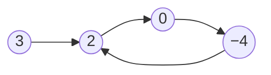

<!-- approaches: Hash set of visited nodes · Floyd's tortoise and hare -->
# 141. Linked List Cycle

**Easy** · Hash Table · Linked List · Two Pointers · Floyd's Cycle Finding Algorithm · [LeetCode ↗](https://leetcode.com/problems/linked-list-cycle/) · Code: [LinkedListCycle.java](LinkedListCycle.java) · Tests: [LinkedListCycleTest.java](LinkedListCycleTest.java)

## Đề bài

Danh sách liên kết có **chu trình** không (đi theo `next` mãi mà gặp lại một node)? Follow-up: `O(1)` bộ nhớ.

```
3 → 2 → 0 → −4
    ↑________|        -> true
```

## Ý tưởng

> **Rùa và thỏ (Floyd)**: thỏ đi 2 bước, rùa đi 1 bước. Không có chu trình → thỏ chạm `null`. Có chu trình → khi cả hai đã vào vòng, mỗi bước thỏ **rút ngắn khoảng cách thêm 1** → chắc chắn đuổi kịp rùa, không thể "nhảy qua".



| bước | slow | fast |
|---|---|---|
| 0 | 3 | 3 |
| 1 | 2 | 0 |
| 2 | 0 | 2 |
| 3 | −4 | −4 → **gặp nhau** |

## Cách 1 — HashSet các node đã thăm `O(n) · O(n)`

So sánh theo **đối tượng node** (tham chiếu), không theo giá trị.

## Cách 2 — Floyd `O(n) · O(1)` ⭐

Kiểm tra `fast != null && fast.next != null` trước khi nhảy hai bước.

## Bài liên quan

142 Linked List Cycle II (tìm điểm bắt đầu chu trình) · 202 Happy Number · 287 Find the Duplicate Number · 876 Middle of the Linked List.
