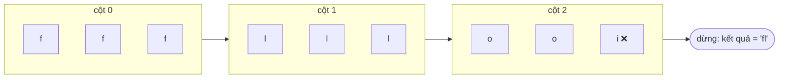

<!-- approaches: Vertical scan · Horizontal shrink · Sort + compare ends -->
# 14. Longest Common Prefix

**Easy** · Array · String · Trie · [LeetCode ↗](https://leetcode.com/problems/longest-common-prefix/) · Code: [LongestCommonPrefix.java](LongestCommonPrefix.java) · Tests: [LongestCommonPrefixTest.java](LongestCommonPrefixTest.java)

## Đề bài

Tìm **tiền tố chung dài nhất** của một mảng chuỗi; không có thì trả `""`.

```
["flower","flow","flight"] -> "fl"        ["dog","racecar","car"] -> ""
```

## Ý tưởng

> Xếp các từ thẳng hàng như một bảng, đọc **theo cột** từ trái sang phải: dừng ở cột đầu tiên mà các từ không còn giống nhau (hoặc một từ đã hết).



## Cách 1 — Quét dọc `O(S) · O(1)` ⭐

So ký tự thứ `i` của từ đầu với cột `i` của mọi từ khác. Dừng ngay khi lệch → không tốn công đọc phần đuôi dài. `S` = tổng số ký tự.

## Cách 2 — Quét ngang (thu hẹp dần) `O(S) · O(1)`

Lấy từ đầu làm tiền tố, gặp từ nào không `startsWith` thì cắt bớt một ký tự cuối cho tới khi khớp.

| bước | từ | prefix |
|---|---|---|
| 0 | flower | flower |
| 1 | flow | flowe → **flow** |
| 2 | flight | flo → **fl** |

## Cách 3 — Sắp xếp rồi so hai đầu `O(n log n · m)`

Sau khi sắp xếp theo thứ tự từ điển, từ **đầu** và từ **cuối** khác nhau nhiều nhất → tiền tố chung của chúng là tiền tố chung của tất cả. Mẹo hay để kể khi phỏng vấn, nhưng chậm hơn cách 1.

## Bẫy & lưu ý

- Một từ có thể chính là tiền tố (`["ab","abc"]` → `"ab"`) → kiểm tra `i == strs[j].length()` trước khi `charAt`.
- Mảng có chuỗi rỗng → kết quả `""`.
- Câu hỏi mở rộng: *nhiều truy vấn trên cùng tập từ?* → dựng **Trie**, đi xuống khi node chỉ có một con và chưa là cuối từ.

## Bài liên quan

208 Implement Trie · 1268 Search Suggestions System.
