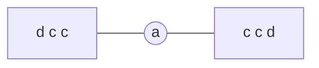

<!-- approaches: Count letters · Set of odd letters -->
# 409. Longest Palindrome

**Easy** · Hash Table · String · Greedy · [LeetCode ↗](https://leetcode.com/problems/longest-palindrome/) · Code: [LongestPalindrome.java](LongestPalindrome.java) · Tests: [LongestPalindromeTest.java](LongestPalindromeTest.java)

## Đề bài

Dùng các chữ cái của `s` (phân biệt hoa thường), tạo được chuỗi đối xứng **dài nhất** là bao nhiêu?

```
"abccccdd" -> 7   (ví dụ "dccaccd")
```

## Ý tưởng

> Chuỗi đối xứng = hai nửa giống nhau + **tối đa một** ký tự ở giữa.
> Mỗi **cặp** chữ giống nhau đặt được ở hai bên; nếu còn dư chữ lẻ nào thì lấy **một** chữ làm tâm.

| chữ | số lượng | dùng được |
|---|---|---|
| a | 1 | 0 (+ có thể làm tâm) |
| b | 1 | 0 |
| c | 4 | 4 |
| d | 2 | 2 |
| | | 6 + 1 tâm = **7** |



## Cách 1 — Đếm chữ ⭐

`length += count / 2 * 2`, cộng thêm 1 nếu có chữ nào số lượng lẻ.

## Cách 2 — Tập các chữ lẻ

Bật/tắt mỗi chữ trong set; còn lại là các chữ có số lượng lẻ. Đáp án = `n − số chữ lẻ + 1` (hoặc `n` nếu không có chữ lẻ).

## Bài liên quan

5 Longest Palindromic Substring · 266 Palindrome Permutation · 2131 Longest Palindrome by Concatenating Two Letter Words.
