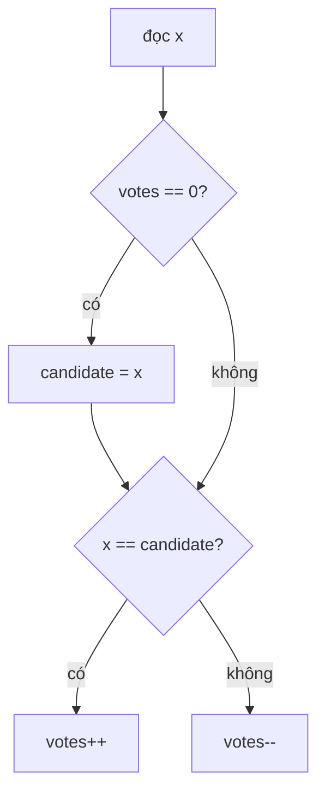

<!-- approaches: Hash map count · Sort and take the middle · Boyer-Moore voting -->
# 169. Majority Element

**Easy** · Array · Hash Table · Divide and Conquer · Sorting · [LeetCode ↗](https://leetcode.com/problems/majority-element/) · Code: [MajorityElement.java](MajorityElement.java) · Tests: [MajorityElementTest.java](MajorityElementTest.java)

## Đề bài

Tìm phần tử xuất hiện **hơn `n/2` lần** (luôn tồn tại). Follow-up: `O(n)` thời gian, `O(1)` bộ nhớ.

```
[2,2,1,1,1,2,2] -> 2
```

## Ý tưởng

> **Bầu cử Boyer–Moore**: ghép cặp mỗi phiếu "đa số" với một phiếu khác để **triệt tiêu**. Vì đa số nhiều hơn **tất cả** phần còn lại cộng lại, sau khi triệt tiêu hết vẫn còn dư phiếu đa số.



`[2, 2, 1, 1, 1, 2, 2]`:

| x | candidate | votes |
|---|---|---|
| 2 | 2 | 1 |
| 2 | 2 | 2 |
| 1 | 2 | 1 |
| 1 | 2 | 0 |
| 1 | **1** | 1 |
| 2 | 1 | 0 |
| 2 | **2** | 1 → đáp án 2 |

Ứng viên có thể đổi giữa chừng — nhưng cuối cùng luôn đúng.

## Cách 1 — HashMap đếm `O(n) · O(n)`

## Cách 2 — Sắp xếp, lấy phần tử giữa `O(n log n)`

Đa số chiếm hơn nửa mảng nên sau khi sắp xếp, nó **luôn phủ vị trí `n/2`**.

## Cách 3 — Boyer–Moore `O(n) · O(1)` ⭐

## Bẫy & lưu ý

- Nếu đề **không đảm bảo** có đa số, phải chạy thêm một lượt đếm để xác nhận ứng viên.

## Bài liên quan

229 Majority Element II (> n/3: giữ **hai** ứng viên) · 1150 Check If a Number Is Majority Element in a Sorted Array.
