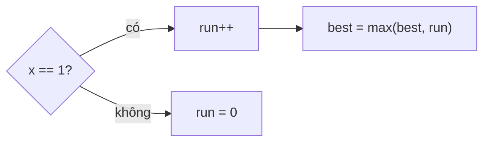

<!-- approaches: Counter reset · Track start of run -->
# 485. Max Consecutive Ones

**Easy** · Array · [LeetCode ↗](https://leetcode.com/problems/max-consecutive-ones/) · Code: [MaxConsecutiveOnes.java](MaxConsecutiveOnes.java) · Tests: [MaxConsecutiveOnesTest.java](MaxConsecutiveOnesTest.java)

## Đề bài

Mảng nhị phân, tìm độ dài dãy `1` **liên tiếp** dài nhất.

```
[1,1,0,1,1,1] -> 3
```

## Ý tưởng

> Một bộ đếm chạy: gặp `1` thì tăng, gặp `0` thì về 0. Ghi lại giá trị lớn nhất từng đạt.

| x | 1 | 1 | 0 | 1 | 1 | 1 |
|---|---|---|---|---|---|---|
| run | 1 | 2 | 0 | 1 | 2 | 3 |
| best | 1 | 2 | 2 | 2 | 2 | **3** |



## Cách 1 — Bộ đếm `O(n)` ⭐

## Cách 2 — Nhớ điểm bắt đầu

`start` = vị trí bắt đầu dãy hiện tại; độ dài = `i − start + 1`. Cùng ý tưởng, nhưng đây là **hình dạng cửa sổ trượt** cần cho các biến thể: 487 (được lật một số 0), 1004 (được lật `k` số 0).

## Bài liên quan

487 Max Consecutive Ones II · 1004 Max Consecutive Ones III · 674 Longest Continuous Increasing Subsequence.
