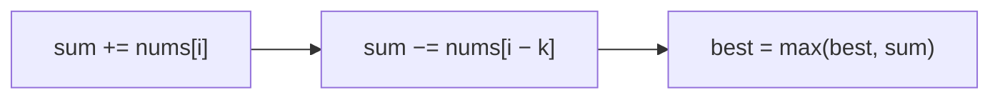

<!-- approaches: Fixed-size sliding window · Prefix sums -->
# 643. Maximum Average Subarray I

**Easy** · Array · Sliding Window · [LeetCode ↗](https://leetcode.com/problems/maximum-average-subarray-i/) · Code: [MaximumAverageSubarrayI.java](MaximumAverageSubarrayI.java) · Tests: [MaximumAverageSubarrayITest.java](MaximumAverageSubarrayITest.java)

## Đề bài

Tìm đoạn con liên tiếp **dài đúng `k`** có trung bình lớn nhất.

```
[1,12,-5,-6,50,3], k = 4 -> 12.75     (12 − 5 − 6 + 50) / 4
```

## Ý tưởng

> **Cửa sổ trượt cố định:** dời cửa sổ sang phải một ô chỉ cần **cộng** phần tử mới vào và **trừ** phần tử vừa rời đi — không cần tính lại tổng. Trung bình lớn nhất ⇔ tổng lớn nhất (vì `k` cố định).

| cửa sổ | tổng |
|---|---|
| [1, 12, −5, −6] | 2 |
| [12, −5, −6, 50] | 2 + 50 − 1 = **51** |
| [−5, −6, 50, 3] | 51 + 3 − 12 = 42 |



## Cách 1 — Cửa sổ trượt `O(n) · O(1)` ⭐

## Cách 2 — Prefix sum

## Bài liên quan

644 Maximum Average Subarray II (Hard) · 1343 Number of Sub-arrays of Size K and Average ≥ Threshold · 239 Sliding Window Maximum.
