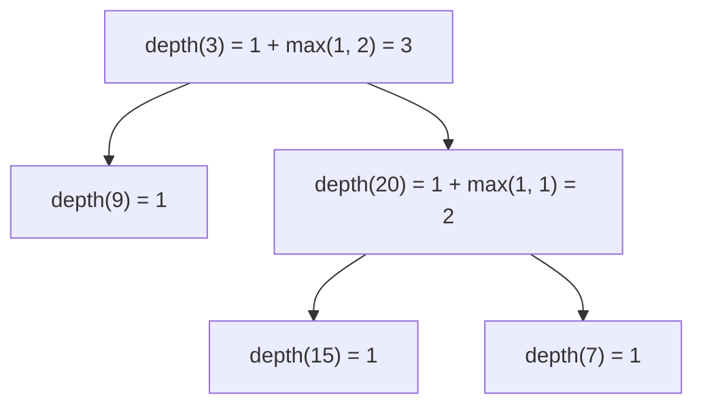

<!-- approaches: Recursive DFS · BFS by levels · Iterative DFS with depth -->
# 104. Maximum Depth of Binary Tree

**Easy** · Tree · Depth-First Search · Breadth-First Search · Binary Tree · [LeetCode ↗](https://leetcode.com/problems/maximum-depth-of-binary-tree/) · Code: [MaximumDepthOfBinaryTree.java](MaximumDepthOfBinaryTree.java) · Tests: [MaximumDepthOfBinaryTreeTest.java](MaximumDepthOfBinaryTreeTest.java)

## Đề bài

Độ sâu lớn nhất của cây = số node trên đường dài nhất từ gốc tới một lá.

```
    3
   / \
  9  20        ->  3
    /  \
   15   7
```

## Ý tưởng

> Độ sâu của cây = `1` (gốc) + độ sâu của cây con **sâu hơn**. Đây là khuôn **"hỏi con rồi tổng hợp"** (postorder) dùng cho hầu hết bài cây.



## Cách 1 — DFS đệ quy `O(n) · O(h)` ⭐

Một dòng: `return root == null ? 0 : 1 + max(depth(left), depth(right))`.

## Cách 2 — BFS theo tầng `O(n)`

Đếm số tầng: mỗi vòng `while` xử lý hết đúng một tầng (lấy `queue.size()` **trước** khi duyệt).

## Cách 3 — DFS bằng stack mang theo độ sâu

Mỗi phần tử stack là cặp `(node, độ sâu)`; cập nhật max mỗi khi lấy ra.

## Bẫy & lưu ý

- Cây rỗng có độ sâu `0`.
- Khuôn BFS "theo tầng" (chốt `size` trước vòng lặp con) dùng lại ở 102, 199, 111, 637.

## Bài liên quan

111 Minimum Depth · 110 Balanced Binary Tree · 543 Diameter of Binary Tree · 102 Level Order Traversal.
