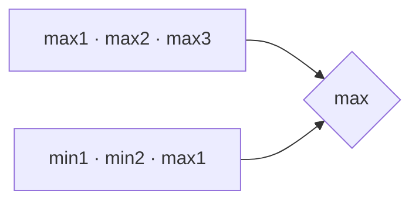

<!-- approaches: Sort · One pass keeping three max and two min -->
# 628. Maximum Product of Three Numbers

**Easy** · Array · Math · Sorting · [LeetCode ↗](https://leetcode.com/problems/maximum-product-of-three-numbers/) · Code: [MaximumProductOfThreeNumbers.java](MaximumProductOfThreeNumbers.java) · Tests: [MaximumProductOfThreeNumbersTest.java](MaximumProductOfThreeNumbersTest.java)

## Đề bài

Chọn ba số có **tích lớn nhất**.

```
[-10,-10,5,2] -> 500    (−10) × (−10) × 5
```

## Ý tưởng

> Hai số âm nhân lại thành dương. Tích lớn nhất chỉ có thể là một trong hai:
> - **ba số lớn nhất**;
> - **hai số nhỏ nhất** (âm, giá trị tuyệt đối lớn) × **số lớn nhất**.



| mảng | ba số lớn nhất | hai nhỏ nhất × lớn nhất |
|---|---|---|
| [−10, −10, 5, 2] | 5·2·(−10) = −100 | (−10)(−10)·5 = **500** |
| [1, 2, 3, 4] | **24** | 1·2·4 = 8 |

## Cách 1 — Sắp xếp `O(n log n)`

## Cách 2 — Một lượt giữ 5 giá trị `O(n)` ⭐

## Bài liên quan

152 Maximum Product Subarray · 1913 Maximum Product Difference Between Two Pairs · 215 Kth Largest Element.
