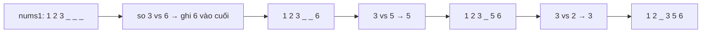

<!-- approaches: Append + sort · Merge from the back -->
# 88. Merge Sorted Array

**Easy** · Array · Two Pointers · Sorting · [LeetCode ↗](https://leetcode.com/problems/merge-sorted-array/) · Code: [MergeSortedArray.java](MergeSortedArray.java) · Tests: [MergeSortedArrayTest.java](MergeSortedArrayTest.java)

## Đề bài

`nums1` dài `m + n`: `m` số đã sắp xếp, theo sau là `n` số 0 (chỗ trống). Trộn `nums2` (đã sắp xếp, dài `n`) vào `nums1` **tại chỗ**.

```
nums1 = [1,2,3,0,0,0], m = 3, nums2 = [2,5,6]  ->  [1,2,2,3,5,6]
```

## Ý tưởng

> Trộn từ đầu sẽ **ghi đè** phần tử chưa đọc của `nums1`. Nhưng **cuối** `nums1` đang trống! Trộn **từ cuối lên**, mỗi lần lấy số **lớn hơn** trong hai đuôi.



| i (nums1) | j (nums2) | k | ghi |
|---|---|---|---|
| 3 | 6 | 5 | 6 |
| 3 | 5 | 4 | 5 |
| 3 | 2 | 3 | 3 |
| 2 | 2 | 2 | 2 (của nums2, vì không `>`) |
| 2 | – | | `nums2` hết → dừng |

## Cách 1 — Chép vào rồi sắp xếp `O((m+n) log(m+n))`

## Cách 2 — Trộn từ cuối `O(m+n) · O(1)` ⭐

Vòng lặp chạy khi `j >= 0`: khi `nums2` hết thì phần còn lại của `nums1` **đã đúng chỗ**, không cần chép.

## Bẫy & lưu ý

- Vì sao không ghi đè? Vị trí ghi `k = i + j + 1 ≥ i` — luôn ở **sau hoặc trùng** phần tử đang đọc của `nums1`.

## Bài liên quan

21 Merge Two Sorted Lists · 977 Squares of a Sorted Array · 88 là bước "merge" của merge sort.
