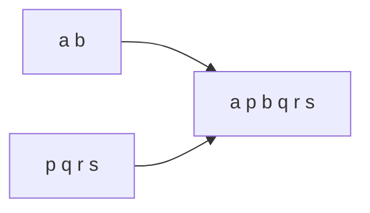

<!-- approaches: Two pointers · Single index -->
# 1768. Merge Strings Alternately

**Easy** · Two Pointers · String · [LeetCode ↗](https://leetcode.com/problems/merge-strings-alternately/) · Code: [MergeStringsAlternately.java](MergeStringsAlternately.java) · Tests: [MergeStringsAlternatelyTest.java](MergeStringsAlternatelyTest.java)

## Đề bài

Trộn hai chuỗi bằng cách lấy **xen kẽ** từng ký tự (bắt đầu từ `word1`); chuỗi dài hơn thì nối phần dư vào cuối.

```
"ab" + "pqrs" -> "a p b q rs" -> "apbqrs"
```

## Ý tưởng

> Hai con trỏ, mỗi chuỗi một con trỏ. Mỗi vòng lấy một ký tự từ chuỗi nào **còn** ký tự.



## Cách 1 — Hai con trỏ `O(m+n)` ⭐

Điều kiện `i < m || j < n` tự xử lý phần dư — không cần vòng lặp thứ hai.

## Cách 2 — Một chỉ số + nối phần đuôi

Xen kẽ tới độ dài chuỗi ngắn hơn, rồi `append` phần còn lại của cả hai (một trong hai là rỗng).

## Bài liên quan

88 Merge Sorted Array · 21 Merge Two Sorted Lists · 1754 Largest Merge Of Two Strings.
