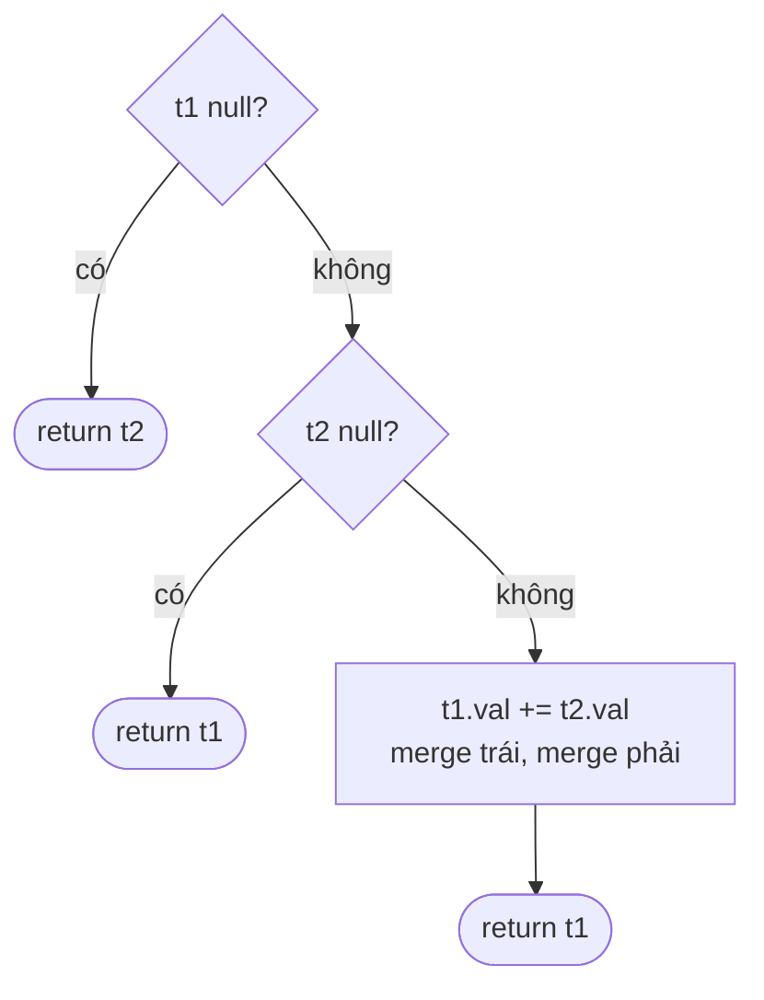

<!-- approaches: Recursive in place · Recursive new tree · Iterative stack -->
# 617. Merge Two Binary Trees

**Easy** · Tree · Depth-First Search · Breadth-First Search · Binary Tree · [LeetCode ↗](https://leetcode.com/problems/merge-two-binary-trees/) · Code: [MergeTwoBinaryTrees.java](MergeTwoBinaryTrees.java) · Tests: [MergeTwoBinaryTreesTest.java](MergeTwoBinaryTreesTest.java)

## Đề bài

Chồng hai cây lên nhau: chỗ nào cả hai cùng có node thì cộng giá trị, chỗ nào chỉ một cây có thì lấy node đó.

```
    1            2               3
   / \          / \             / \
  3   2   +    1   3     =>    4   5
 /              \   \         / \   \
5                4   7       5   4   7
```

## Ý tưởng

> Duyệt **song song** hai cây cùng một hình dạng đường đi. Khi một bên hết (`null`), lấy **nguyên cây con** của bên kia — không cần đi sâu nữa.



## Cách 1 — Đệ quy, ghi vào `t1` ⭐

Chỉ thăm phần **giao nhau** của hai cây: `O(min(m, n))`.

## Cách 2 — Đệ quy, tạo cây mới

Không sửa đầu vào. Tốn `O(m + n)` vì phải sao chép cả phần không giao.

## Cách 3 — Stack các cặp node

Như cách 1 nhưng không đệ quy: mỗi phần tử stack là cặp `(node của t1, node của t2)`.

## Bẫy & lưu ý

- Cách 1 và 3 **dùng chung node** với cây đầu vào — hỏi người phỏng vấn có được phép không.

## Bài liên quan

100 Same Tree · 226 Invert Binary Tree · 101 Symmetric Tree.
