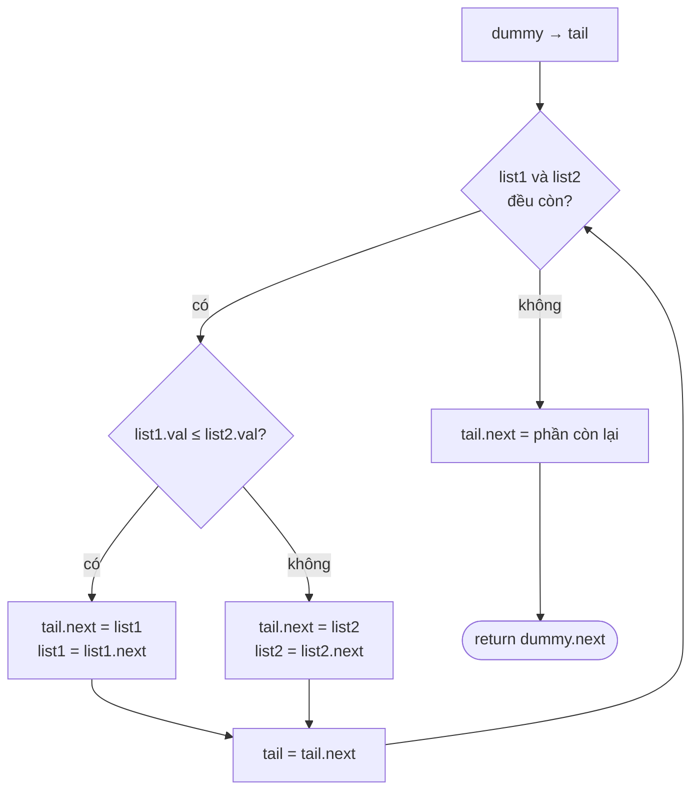

<!-- approaches: Iterative with dummy head · Recursive -->
# 21. Merge Two Sorted Lists

**Easy** · Linked List · Recursion · [LeetCode ↗](https://leetcode.com/problems/merge-two-sorted-lists/) · Code: [MergeTwoSortedLists.java](MergeTwoSortedLists.java) · Tests: [MergeTwoSortedListsTest.java](MergeTwoSortedListsTest.java)

## Đề bài

Ghép hai danh sách liên kết **đã sắp xếp** thành một danh sách sắp xếp, bằng cách **nối lại các node có sẵn**.

```
1 → 2 → 4
1 → 3 → 4      =>   1 → 1 → 2 → 3 → 4 → 4
```

## Ý tưởng

> Như trộn hai chồng bài đã xếp: mỗi lần lấy lá **nhỏ hơn** ở đầu hai chồng, đặt vào chồng kết quả.
> Một chồng hết thì úp nguyên phần còn lại của chồng kia lên.

## Cách 1 — Lặp với node giả (dummy) `O(m+n) · O(1)` ⭐

`dummy` là node "đứng trước đầu" để không phải xử lý riêng trường hợp danh sách kết quả đang rỗng.



Chạy tay:

| list1 | list2 | lấy | kết quả |
|---|---|---|---|
| 1,2,4 | 1,3,4 | 1 (list1, `≤`) | 1 |
| 2,4 | 1,3,4 | 1 | 1,1 |
| 2,4 | 3,4 | 2 | 1,1,2 |
| 4 | 3,4 | 3 | 1,1,2,3 |
| 4 | 4 | 4 (list1) | 1,1,2,3,4 |
| – | 4 | nối phần còn lại | 1,1,2,3,4,4 |

## Cách 2 — Đệ quy `O(m+n) · O(m+n)` stack

`merge(a, b)`: đầu nhỏ hơn đứng trước, `next` của nó = `merge(phần còn lại)`. Code đẹp, nhưng danh sách dài 10⁵ có thể tràn stack.

## Bẫy & lưu ý

- Dùng `≤` (không phải `<`) để giữ thứ tự ổn định (stable) khi bằng nhau.
- Đừng quên nối **phần còn lại** sau vòng lặp — đó là lý do không cần vòng lặp thứ hai.
- Node giả `dummy` là kỹ thuật dùng lại rất nhiều trong các bài linked list.

## Bài liên quan

23 Merge k Sorted Lists (Hard) · 88 Merge Sorted Array · 148 Sort List (merge sort trên list).
