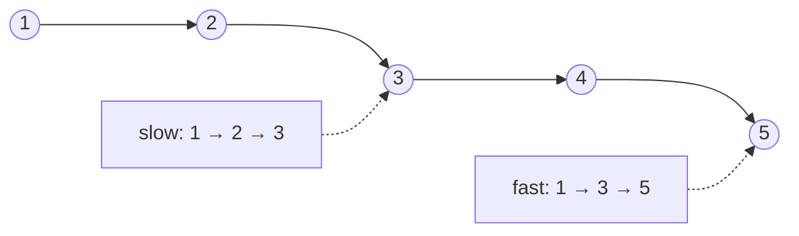

<!-- approaches: Count then walk · Array of nodes · Slow/fast pointers -->
# 876. Middle of the Linked List

**Easy** · Linked List · Two Pointers · [LeetCode ↗](https://leetcode.com/problems/middle-of-the-linked-list/) · Code: [MiddleOfTheLinkedList.java](MiddleOfTheLinkedList.java) · Tests: [MiddleOfTheLinkedListTest.java](MiddleOfTheLinkedListTest.java)

## Đề bài

Trả về node **giữa** của danh sách liên kết; có hai node giữa thì lấy node **thứ hai**.

```
1 → 2 → 3 → 4 → 5        -> 3
1 → 2 → 3 → 4 → 5 → 6    -> 4
```

## Ý tưởng

> **Rùa và thỏ**: thỏ đi gấp đôi rùa. Khi thỏ tới đích, rùa mới đi được nửa đường.



## Cách 1 — Đếm rồi đi `O(n)`, hai lượt

## Cách 2 — Mảng node `O(n)` bộ nhớ

Lưu tham chiếu các node, trả `nodes[n/2]`.

## Cách 3 — Con trỏ nhanh / chậm, một lượt, `O(1)` ⭐

| bước | slow | fast (6 node) |
|---|---|---|
| 0 | 1 | 1 |
| 1 | 2 | 3 |
| 2 | 3 | 5 |
| 3 | **4** | null → dừng |

Điều kiện `fast != null && fast.next != null` cho đúng "node giữa thứ hai" khi độ dài chẵn.
Muốn lấy node giữa **thứ nhất** (cần cho 234, 143): đổi thành `fast.next != null && fast.next.next != null`.

## Bài liên quan

141 Linked List Cycle · 234 Palindrome Linked List · 143 Reorder List · 2095 Delete the Middle Node.
