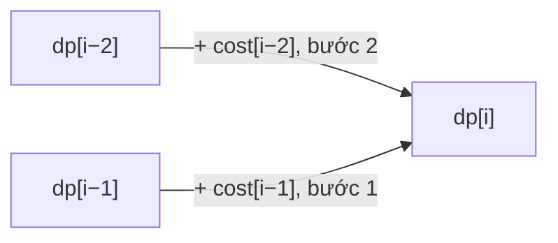

<!-- approaches: Memoized recursion · DP array · Two variables -->
# 746. Min Cost Climbing Stairs

**Easy** · Array · Dynamic Programming · [LeetCode ↗](https://leetcode.com/problems/min-cost-climbing-stairs/) · Code: [MinCostClimbingStairs.java](MinCostClimbingStairs.java) · Tests: [MinCostClimbingStairsTest.java](MinCostClimbingStairsTest.java)

## Đề bài

`cost[i]` là phí đứng lên bậc `i`; trả phí xong được bước 1 hoặc 2 bậc. Bắt đầu ở bậc 0 hoặc 1 (miễn phí). Tìm chi phí nhỏ nhất để lên **đỉnh** (vượt qua bậc cuối).

```
cost = [10, 15, 20] -> 15   (bắt đầu ở bậc 1, trả 15, bước 2 bậc lên đỉnh)
```

## Ý tưởng

> Giống 70 Climbing Stairs, nhưng thay "đếm số cách" bằng "**chi phí nhỏ nhất**":
> `dp[i]` = chi phí rẻ nhất để **đứng** ở vị trí `i` = `min(dp[i−1] + cost[i−1], dp[i−2] + cost[i−2])`.



`cost = [10, 15, 20]`, đỉnh là vị trí 3:

| i | 0 | 1 | 2 | 3 (đỉnh) |
|---|---|---|---|---|
| dp[i] | 0 | 0 | min(0+15, 0+10) = 10 | min(10+20, 0+15) = **15** |

## Cách 1 — Đệ quy có nhớ `O(n)`

## Cách 2 — Mảng DP `O(n) · O(n)`

## Cách 3 — Hai biến `O(n) · O(1)` ⭐

## Bẫy & lưu ý

- "Đỉnh" là vị trí `n`, **sau** bậc cuối — mảng dp dài `n + 1`.
- `dp[0] = dp[1] = 0` vì được chọn bắt đầu ở bậc 0 hoặc 1 miễn phí.

## Bài liên quan

70 Climbing Stairs · 198 House Robber · 1137 N-th Tribonacci Number.
