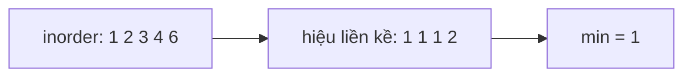

<!-- approaches: Inorder to list · Inorder with previous value -->
# 530. Minimum Absolute Difference in BST

**Easy** · Tree · Depth-First Search · Breadth-First Search · Binary Search Tree · [LeetCode ↗](https://leetcode.com/problems/minimum-absolute-difference-in-bst/) · Code: [MinimumAbsoluteDifferenceInBST.java](MinimumAbsoluteDifferenceInBST.java) · Tests: [MinimumAbsoluteDifferenceInBSTTest.java](MinimumAbsoluteDifferenceInBSTTest.java)

## Đề bài

Hiệu tuyệt đối **nhỏ nhất** giữa hai node bất kỳ trong BST.

```
      4
     / \
    2   6      -> 1
   / \
  1   3
```

## Ý tưởng

> Duyệt **inorder** BST cho dãy **tăng dần**. Trong dãy đã sắp xếp, hai số gần nhau nhất luôn là **hai số liền kề** → chỉ cần so mỗi số với số đứng trước nó.



## Cách 1 — Inorder ra danh sách `O(n) · O(n)`

## Cách 2 — Inorder nhớ giá trị trước `O(n) · O(h)` ⭐

Không cần lưu cả dãy, chỉ cần `prev`.

## Bẫy & lưu ý

- Với cây **không phải** BST thì không áp dụng được — phải lấy hết giá trị rồi sắp xếp.

## Bài liên quan

783 Minimum Distance Between BST Nodes (giống hệt) · 98 Validate BST · 230 Kth Smallest Element in a BST · 501 Find Mode in BST.
