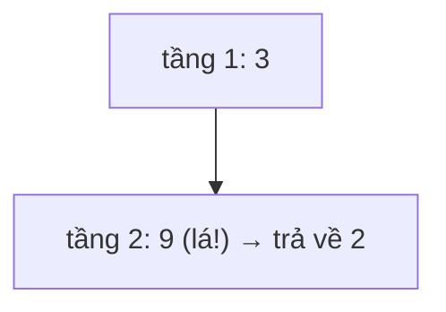

<!-- approaches: BFS stopping at the first leaf · Recursive DFS -->
# 111. Minimum Depth of Binary Tree

**Easy** · Tree · Depth-First Search · Breadth-First Search · Binary Tree · [LeetCode ↗](https://leetcode.com/problems/minimum-depth-of-binary-tree/) · Code: [MinimumDepthOfBinaryTree.java](MinimumDepthOfBinaryTree.java) · Tests: [MinimumDepthOfBinaryTreeTest.java](MinimumDepthOfBinaryTreeTest.java)

## Đề bài

Độ sâu nhỏ nhất = số node trên đường ngắn nhất từ gốc xuống **một lá**.

```
    3
   / \
  9  20       -> 2   (3 → 9)
    /  \
   15   7
```

## Ý tưởng

> **BFS** thăm theo tầng → **lá đầu tiên** gặp được nằm ở tầng nông nhất → dừng ngay, không cần duyệt hết cây.



## Cách 1 — BFS dừng sớm ⭐

## Cách 2 — Đệ quy

**Bẫy:** viết `1 + min(trái, phải)` như bài 104 là **sai** khi một con rỗng — node chỉ có một con **không phải lá**, độ sâu 0 của nhánh rỗng không được tính. Cây "dây" `2 → 3 → 4 → 5 → 6` có độ sâu nhỏ nhất là 5, không phải 1.

## Bài liên quan

104 Maximum Depth · 102 Level Order Traversal · 112 Path Sum.
