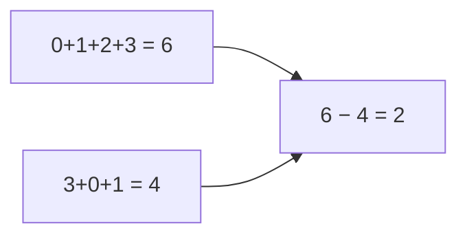

<!-- approaches: Sort · Hash set · Gauss sum · XOR -->
# 268. Missing Number

**Easy** · Array · Hash Table · Math · Binary Search · [LeetCode ↗](https://leetcode.com/problems/missing-number/) · Code: [MissingNumber.java](MissingNumber.java) · Tests: [MissingNumberTest.java](MissingNumberTest.java)

## Đề bài

Mảng gồm `n` số **khác nhau** lấy từ `[0, n]`. Tìm số duy nhất bị thiếu. Follow-up: `O(1)` bộ nhớ, `O(n)` thời gian.

```
[3,0,1] -> 2
```

## Ý tưởng

> Ta biết **tổng / XOR đầy đủ** của `0..n` phải là bao nhiêu. So với cái đang có, phần chênh lệch chính là số thiếu.



## Cách 1 — Sắp xếp `O(n log n)`

Vị trí đầu tiên mà `a[i] ≠ i` là số thiếu.

## Cách 2 — HashSet `O(n) · O(n)`

## Cách 3 — Công thức Gauss `O(n) · O(1)` ⭐

`n(n+1)/2 − Σ nums`. Với `n ≤ 10⁴`, tổng tối đa ~5·10⁷ — vừa `int`.

## Cách 4 — XOR `O(n) · O(1)`

XOR mọi chỉ số `0..n` với mọi giá trị: số nào có mặt xuất hiện hai lần (một lần là chỉ số, một lần là giá trị) và triệt tiêu.

| | 0 | 1 | 2 | 3 |
|---|---|---|---|---|
| chỉ số (0..3) | ✓ | ✓ | ✓ | ✓ |
| giá trị [3,0,1] | ✓ | ✓ | | ✓ |
| còn lại | | | **2** | |

Không bao giờ tràn số — điểm hơn công thức tổng khi `n` lớn.

## Bài liên quan

136 Single Number · 41 First Missing Positive (Hard) · 448 Find All Numbers Disappeared in an Array · 287 Find the Duplicate Number.
