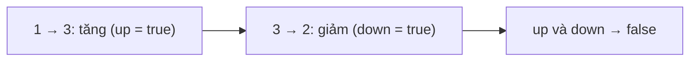

<!-- approaches: Two flags in one pass · Direction from first difference -->
# 896. Monotonic Array

**Easy** · Array · [LeetCode ↗](https://leetcode.com/problems/monotonic-array/) · Code: [MonotonicArray.java](MonotonicArray.java) · Tests: [MonotonicArrayTest.java](MonotonicArrayTest.java)

## Đề bài

Mảng có **đơn điệu** không — hoặc không giảm toàn bộ, hoặc không tăng toàn bộ?

```
[1,2,2,3] -> true      [6,5,4,4] -> true      [1,3,2] -> false
```

## Ý tưởng

> Mảng **không** đơn điệu ⇔ có ít nhất một lần **tăng** và ít nhất một lần **giảm**. Hai cờ là đủ.



## Cách 1 — Hai cờ `O(n)` ⭐

Dừng sớm ngay khi cả hai cờ bật.

## Cách 2 — Chốt hướng ở chênh lệch khác 0 đầu tiên

Các cặp bằng nhau thì bỏ qua; cặp khác nhau đầu tiên quyết định hướng, mọi cặp sau phải cùng hướng.

## Bài liên quan

852 Peak Index in a Mountain Array · 941 Valid Mountain Array.
