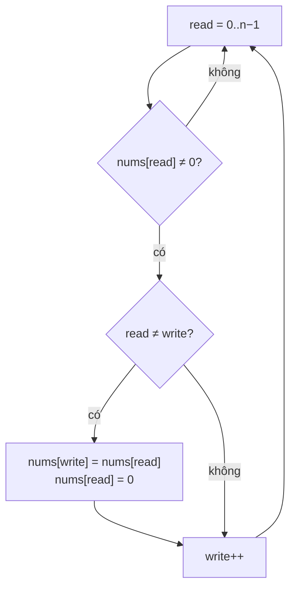

<!-- approaches: Extra array · Write pointer + fill zeros · Swap with write pointer -->
# 283. Move Zeroes

**Easy** · Array · Two Pointers · [LeetCode ↗](https://leetcode.com/problems/move-zeroes/) · Code: [MoveZeroes.java](MoveZeroes.java) · Tests: [MoveZeroesTest.java](MoveZeroesTest.java)

## Đề bài

Dồn mọi số `0` về cuối mảng **tại chỗ**, giữ nguyên thứ tự các số khác 0. Follow-up: ít thao tác nhất.

```
[0,1,0,3,12] -> [1,3,12,0,0]
```

## Ý tưởng

> Khuôn **read/write pointer** (như 27 Remove Element): `read` đi qua mọi phần tử, `write` là chỗ cho số khác 0 tiếp theo. Phần `[0, write)` luôn là các số khác 0 theo đúng thứ tự.

## Cách 1 — Mảng phụ `O(n) · O(n)`

## Cách 2 — Dồn rồi lấp 0 `O(n) · O(1)`

Dồn số khác 0 lên đầu, rồi ghi 0 vào phần còn lại.

## Cách 3 — Hoán đổi với vị trí `write` `O(n) · O(1)` ⭐



| read | mảng | write |
|---|---|---|
| 0 (0) | 0 1 0 3 12 | 0 |
| 1 (1) | **1** 0 0 3 12 | 1 |
| 2 (0) | 1 0 0 3 12 | 1 |
| 3 (3) | 1 **3** 0 0 12 | 2 |
| 4 (12) | 1 3 **12** 0 0 | 3 |

Không ghi gì khi chưa gặp số 0 nào (`read == write`) — tối ưu cho follow-up "ít thao tác".

## Bài liên quan

27 Remove Element · 26 Remove Duplicates from Sorted Array · 905 Sort Array By Parity.
