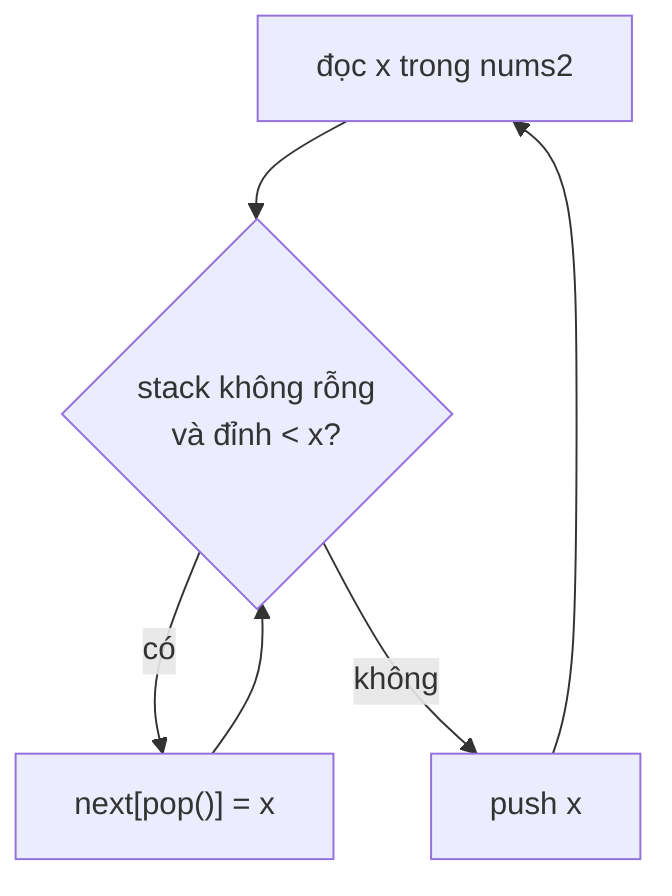

<!-- approaches: Brute force · Monotonic stack + map -->
# 496. Next Greater Element I

**Easy** · Array · Hash Table · Stack · Monotonic Stack · [LeetCode ↗](https://leetcode.com/problems/next-greater-element-i/) · Code: [NextGreaterElementI.java](NextGreaterElementI.java) · Tests: [NextGreaterElementITest.java](NextGreaterElementITest.java)

## Đề bài

Với mỗi `x` trong `nums1` (là tập con của `nums2`), tìm phần tử **lớn hơn đầu tiên bên phải** `x` trong `nums2`; không có → `−1`.

```
nums1 = [4,1,2], nums2 = [1,3,4,2]  ->  [-1, 3, -1]
```

## Ý tưởng

> **Stack đơn điệu giảm**: các số đang "chờ" tìm số lớn hơn nằm trong stack, giảm dần từ đáy lên đỉnh.
> Khi một số lớn hơn tới, nó **giải quyết** mọi số nhỏ hơn đang chờ ở đỉnh — chính nó là "số lớn hơn tiếp theo" của chúng.

Đây là khuôn **monotonic stack** — mở đầu cho 739, 503, 84, 42.

## Cách 1 — Vét cạn `O(m·n)`

## Cách 2 — Stack đơn điệu + HashMap `O(m + n)` ⭐



`nums2 = [1, 3, 4, 2]`:

| x | pop & ghi | stack sau |
|---|---|---|
| 1 | | 1 |
| 3 | next[1] = 3 | 3 |
| 4 | next[3] = 4 | 4 |
| 2 | | 4 2 |
| hết | 4, 2 không có → −1 | |

Mỗi số được push và pop **tối đa một lần** → tổng `O(n)` dù có vòng `while` lồng.

## Bài liên quan

503 Next Greater Element II (mảng vòng) · 739 Daily Temperatures · 84 Largest Rectangle in Histogram · 901 Online Stock Span.
