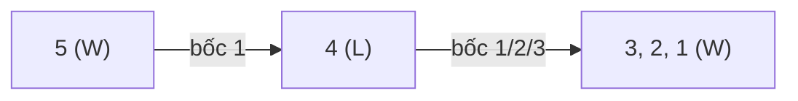

<!-- approaches: Recursive game DP · Math (n % 4) -->
# 292. Nim Game

**Easy** · Math · Brainteaser · Minimax · Game Theory · [LeetCode ↗](https://leetcode.com/problems/nim-game/) · Code: [NimGame.java](NimGame.java) · Tests: [NimGameTest.java](NimGameTest.java)

## Đề bài

Đống `n` viên đá, hai người lần lượt bốc 1–3 viên, ai bốc viên cuối **thắng**. Bạn đi trước, cả hai chơi tối ưu. Bạn có thắng không?

## Ý tưởng

> Một thế là **thắng** nếu có **một nước đi** đẩy đối thủ vào thế **thua**; là **thua** nếu mọi nước đi đều đưa đối thủ vào thế thắng.
> Lập bảng vài giá trị đầu là thấy quy luật lặp lại chu kỳ 4.

| n | 1 | 2 | 3 | 4 | 5 | 6 | 7 | 8 |
|---|---|---|---|---|---|---|---|---|
| | W | W | W | **L** | W | W | W | **L** |

Với `n = 4`: bốc 1, 2 hay 3 thì đối thủ còn 3, 2 hay 1 — đều bốc hết được. Với `n = 5`: bốc 1, để lại 4 cho đối thủ.

**Chiến lược thắng**: luôn để lại cho đối thủ một bội số của 4 (nếu họ bốc `k`, bạn bốc `4 − k`).

## Cách 1 — DP trên thế cờ `O(n)`

Đúng cho mọi trò chơi kiểu này, nhưng `n` tới 2³¹ thì không chạy nổi — dùng để **phát hiện** và **kiểm chứng** quy luật (test làm đúng vậy).

## Cách 2 — `n % 4 != 0` `O(1)` ⭐

## Bài liên quan

877 Stone Game · 1025 Divisor Game · 464 Can I Win · 1510 Stone Game IV.
