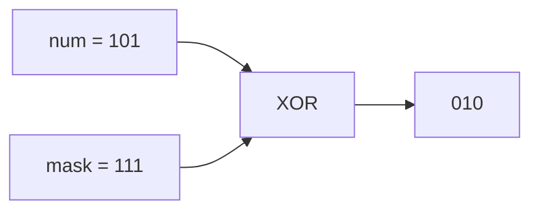

<!-- approaches: Flip bit by bit · Mask of ones -->
# 476. Number Complement

**Easy** · Bit Manipulation · [LeetCode ↗](https://leetcode.com/problems/number-complement/) · Code: [NumberComplement.java](NumberComplement.java) · Tests: [NumberComplementTest.java](NumberComplementTest.java)

## Đề bài

Lật mọi bit trong biểu diễn nhị phân (không tính số 0 đứng đầu).

```
5 = 101  ->  010 = 2
```

## Ý tưởng

> XOR với `1` lật bit. Tạo một **mặt nạ toàn bit 1** dài đúng bằng số bit của `num`, rồi `num ^ mask`.

```
num            = 0000 0101
highestOneBit  = 0000 0100
<< 1           = 0000 1000
− 1  (mask)    = 0000 0111
num ^ mask     = 0000 0010  = 2
```



## Cách 1 — Lật từng bit `O(log n)`

## Cách 2 — Mặt nạ `O(1)` ⭐

`Integer.highestOneBit(num)` giữ lại bit 1 cao nhất. Với `num = 2³¹ − 1`, `<< 1` tràn thành số âm nhỏ nhất nhưng `− 1` lại ra `2³¹ − 1` — vẫn đúng.

## Bẫy & lưu ý

- `~num` lật cả 32 bit, gồm cả các số 0 đứng đầu → ra số âm. Phải dùng mặt nạ.

## Bài liên quan

1009 Complement of Base 10 Integer (giống hệt, nhưng `0 → 1`) · 191 Number of 1 Bits.
