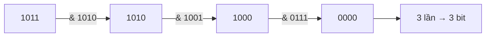

<!-- approaches: Check each bit · Clear lowest set bit · Bit tricks (SWAR) -->
# 191. Number of 1 Bits

**Easy** · Divide and Conquer · Bit Manipulation · [LeetCode ↗](https://leetcode.com/problems/number-of-1-bits/) · Code: [NumberOf1Bits.java](NumberOf1Bits.java) · Tests: [NumberOf1BitsTest.java](NumberOf1BitsTest.java)

## Đề bài

Đếm số bit `1` trong biểu diễn nhị phân của một số (Hamming weight).

```
11 = 1011₂ -> 3
```

## Ý tưởng

> `n & (n − 1)` **xoá bit 1 thấp nhất** của `n`. Lặp tới khi `n = 0`, số lần lặp đúng bằng số bit 1.

```
n       = 1011 0100
n − 1   = 1011 0011     (bit 1 thấp nhất thành 0, các bit 0 phía sau thành 1)
n & n−1 = 1011 0000     -> đã xoá đúng một bit
```



## Cách 1 — Xét từng bit `O(32)`

`(n >>> i) & 1`. Dùng `>>>` (dịch không dấu) để số âm cũng đúng.

## Cách 2 — Brian Kernighan `O(số bit 1)` ⭐

## Cách 3 — Cộng song song (SWAR) `O(1)`

Cộng bit theo cặp, rồi theo nhóm 4, rồi theo byte bằng các mặt nạ `0x5555…`, `0x3333…`, `0x0f0f…`. Đây là cách `Integer.bitCount` cài đặt; biết tên là đủ.

## Bẫy & lưu ý

- Java không có `unsigned int`: đầu vào `11111111111111111111111111111101₂` là số âm. Dùng `>>>` hoặc cách 2 (vòng lặp vẫn dừng vì `n &= n−1` tiến về 0).
- Follow-up: gọi hàm rất nhiều lần → bảng tra 256 phần tử cho từng byte.

## Bài liên quan

338 Counting Bits · 461 Hamming Distance · 231 Power of Two · 190 Reverse Bits.
