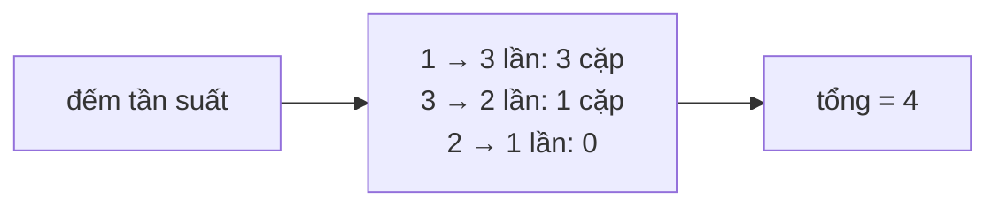

<!-- approaches: Brute force · Count while scanning · Combinatorics -->
# 1512. Number of Good Pairs

**Easy** · Array · Hash Table · Math · Counting · [LeetCode ↗](https://leetcode.com/problems/number-of-good-pairs/) · Code: [NumberOfGoodPairs.java](NumberOfGoodPairs.java) · Tests: [NumberOfGoodPairsTest.java](NumberOfGoodPairsTest.java)

## Đề bài

Đếm số cặp `(i, j)`, `i < j`, có `nums[i] == nums[j]`.

```
[1,2,3,1,1,3] -> 4   (0,3) (0,4) (3,4) (2,5)
```

## Ý tưởng

> Khi gặp một giá trị `x` **lần thứ c+1**, nó tạo cặp với **c** lần xuất hiện trước đó. Cộng dồn khi duyệt là xong.

## Cách 1 — Vét cạn `O(n²)`

## Cách 2 — Đếm trong lúc duyệt `O(n)` ⭐

`count += seen[x]++` — cộng số lần đã gặp **trước** khi tăng.

| x | seen[x] trước | count |
|---|---|---|
| 1 | 0 | 0 |
| 2 | 0 | 0 |
| 3 | 0 | 0 |
| 1 | 1 | 1 |
| 1 | 2 | 3 |
| 3 | 1 | **4** |

## Cách 3 — Tổ hợp `O(n)`

Giá trị xuất hiện `c` lần cho `C(c, 2) = c(c−1)/2` cặp.



## Bẫy & lưu ý

- `0 + 1 + 2 + … + (c−1) = c(c−1)/2` — hai cách 2 và 3 là cùng một công thức.
- Giá trị chỉ từ 1..100 → mảng thay cho HashMap.

## Bài liên quan

1 Two Sum · 2006 Count Number of Pairs With Absolute Difference K · 560 Subarray Sum Equals K.
