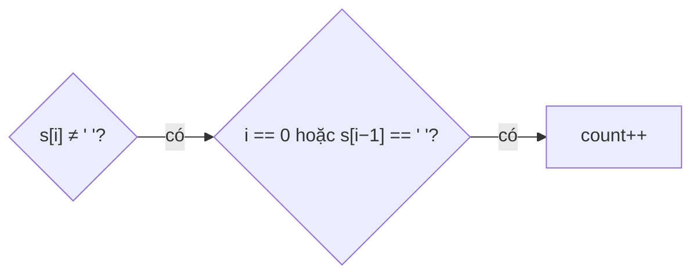

<!-- approaches: Count word starts · Split -->
# 434. Number of Segments in a String

**Easy** · String · [LeetCode ↗](https://leetcode.com/problems/number-of-segments-in-a-string/) · Code: [NumberOfSegmentsInAString.java](NumberOfSegmentsInAString.java) · Tests: [NumberOfSegmentsInAStringTest.java](NumberOfSegmentsInAStringTest.java)

## Đề bài

Đếm số **đoạn** (dãy ký tự khác dấu cách liên tiếp, dài nhất có thể).

```
"Hello, my name is John" -> 5      "   " -> 0
```

## Ý tưởng

> Đếm số **điểm bắt đầu** đoạn: một ký tự khác dấu cách mà đứng **đầu chuỗi** hoặc **ngay sau dấu cách**.

```
"  Hi  you "
   ^    ^      -> 2 điểm bắt đầu
```



## Cách 1 — Đếm điểm bắt đầu `O(n) · O(1)` ⭐

## Cách 2 — `trim` + `split(" +")`

**Bẫy:** `"".split(" ")` trả về mảng **một** phần tử rỗng — phải xử lý chuỗi rỗng riêng.

## Bài liên quan

58 Length of Last Word · 151 Reverse Words in a String · 557 Reverse Words in a String III.
