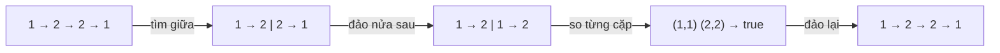

<!-- approaches: Copy to array · Recursion from the end · Reverse second half -->
# 234. Palindrome Linked List

**Easy** · Linked List · Two Pointers · Stack · Recursion · [LeetCode ↗](https://leetcode.com/problems/palindrome-linked-list/) · Code: [PalindromeLinkedList.java](PalindromeLinkedList.java) · Tests: [PalindromeLinkedListTest.java](PalindromeLinkedListTest.java)

## Đề bài

Danh sách liên kết đơn có **đối xứng** không? Follow-up: `O(n)` thời gian, `O(1)` bộ nhớ.

```
1 → 2 → 2 → 1   -> true
```

## Ý tưởng

> Danh sách đơn chỉ đi được một chiều nên không thể "đi ngược từ cuối". Giải pháp `O(1)`: **đảo ngược nửa sau**, rồi đi song song hai nửa và so sánh.

Ghép ba kỹ thuật đã học: con trỏ nhanh/chậm (876) + đảo danh sách (206) + so sánh hai danh sách.



## Cách 1 — Chép ra mảng `O(n) · O(n)`

## Cách 2 — Đệ quy

Đệ quy đi tới **cuối** trước; khi các lời gọi trả về (từ cuối lên đầu), so với con trỏ `front` đang tiến từ đầu xuống. Đẹp nhưng stack `O(n)`.

## Cách 3 — Đảo nửa sau `O(n) · O(1)` ⭐

1. Con trỏ nhanh/chậm, điều kiện `fast.next != null && fast.next.next != null` để `slow` dừng ở **cuối nửa đầu**.
2. Đảo `slow.next …` (nửa sau).
3. So hai nửa (nửa sau ngắn hơn hoặc bằng — với độ dài lẻ, phần tử giữa thuộc nửa đầu và không cần so).
4. **Đảo lại** để khôi phục danh sách — người phỏng vấn rất để ý chi tiết này.

## Bài liên quan

206 Reverse Linked List · 876 Middle of the Linked List · 143 Reorder List · 125 Valid Palindrome.
