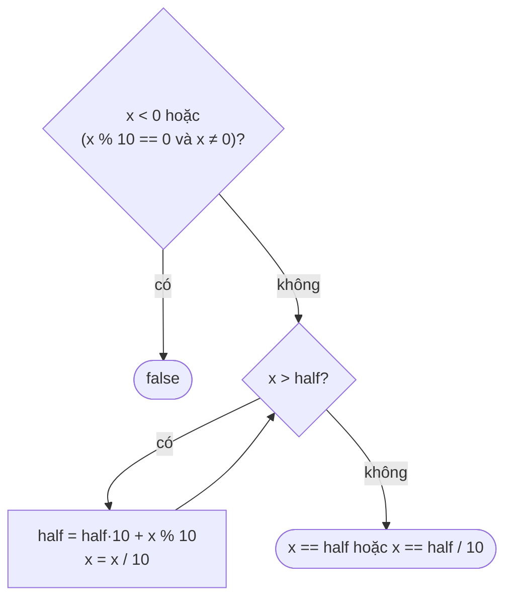

<!-- approaches: String reverse · Full number reverse · Half reverse -->
# 9. Palindrome Number

**Easy** · Math · [LeetCode ↗](https://leetcode.com/problems/palindrome-number/) · Code: [PalindromeNumber.java](PalindromeNumber.java) · Tests: [PalindromeNumberTest.java](PalindromeNumberTest.java)

## Đề bài

Số nguyên `x` có phải **số đối xứng** (đọc xuôi = đọc ngược) không? Follow-up: không chuyển sang chuỗi.

```
121 -> true      -121 -> false (đọc ngược là "121-")      10 -> false
```

## Ý tưởng

> Tách chữ số bằng `% 10` (lấy chữ số cuối) và `/ 10` (bỏ chữ số cuối), dựng số đảo ngược rồi so sánh.
> Chỉ cần đảo **nửa sau** là đủ: nửa sau đảo ngược phải bằng nửa trước.

## Cách 1 — Chuỗi `O(d) · O(d)`

`"121".reverse() == "121"`. Ngắn gọn nhưng không đạt follow-up.

## Cách 2 — Đảo cả số `O(d) · O(1)`

Dựng `reversed = reversed * 10 + y % 10`. Dùng `long` vì đảo `2147483647` sẽ tràn `int`.

## Cách 3 — Đảo nửa sau `O(d/2) · O(1)` ⭐

Cắt chữ số từ cuối `x` sang `half` cho tới khi `half ≥ x` — lúc đó đã đi qua giữa số.



Chạy tay `x = 12321`:

| bước | x | half |
|---|---|---|
| 0 | 12321 | 0 |
| 1 | 1232 | 1 |
| 2 | 123 | 12 |
| 3 | 12 | 123 → dừng (x ≤ half) |

Độ dài lẻ: chữ số giữa (`3`) nằm cuối `half` → so `x == half / 10` → `12 == 12` ✅.

## Bẫy & lưu ý

- Số âm luôn `false` (dấu `-` chỉ ở đầu).
- Số tận cùng `0` (trừ chính `0`) luôn `false`: chữ số đầu không thể là 0. Thiếu điều kiện này, cách 3 sai với `10` (half = 1, x = 0 → `0 == 1/10` → true!).
- Đảo cả số trong `int` có thể tràn — dùng `long` hoặc đảo một nửa.

## Bài liên quan

7 Reverse Integer · 125 Valid Palindrome · 234 Palindrome Linked List.
