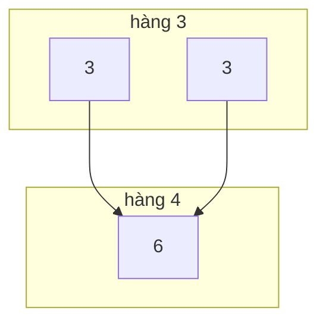

<!-- approaches: Row from previous row · Binomial coefficients -->
# 118. Pascal's Triangle

**Easy** · Array · Dynamic Programming · [LeetCode ↗](https://leetcode.com/problems/pascals-triangle/) · Code: [PascalsTriangle.java](PascalsTriangle.java) · Tests: [PascalsTriangleTest.java](PascalsTriangleTest.java)

## Đề bài

Sinh `numRows` hàng đầu của **tam giác Pascal**: mỗi số bằng tổng hai số ngay phía trên.

```
        1
       1 1
      1 2 1
     1 3 3 1
    1 4 6 4 1
```

## Ý tưởng

> Hai đầu mỗi hàng luôn là `1`; phần giữa: `row[i][j] = row[i−1][j−1] + row[i−1][j]`.



## Cách 1 — Dựng từ hàng trên `O(n²)` ⭐

Xem code: `j == 0 || j == i` → 1, còn lại cộng hai số phía trên. Đây là DP đơn giản nhất: mỗi hàng là "trạng thái" sinh ra từ hàng trước.

## Cách 2 — Hệ số nhị thức `O(n²)`

Hàng `i` chính là `C(i, 0), C(i, 1), …, C(i, i)`. Đi trong hàng bằng công thức
`C(i, j+1) = C(i, j) · (i − j) / (j + 1)` — không cần hàng trên. Hữu ích cho bài 119 (chỉ cần **một hàng**).

| j | C(4, j) | tính |
|---|---|---|
| 0 | 1 | |
| 1 | 4 | 1 · 4 / 1 |
| 2 | 6 | 4 · 3 / 2 |
| 3 | 4 | 6 · 2 / 3 |
| 4 | 1 | 4 · 1 / 4 |

## Bẫy & lưu ý

- Ở cách 2 phải **nhân trước, chia sau**, và dùng `long` — phép chia luôn chia hết nhưng tích trung gian có thể lớn.
- Kết quả có `n(n+1)/2` số nên `O(n²)` là tối ưu.

## Bài liên quan

119 Pascal's Triangle II (một hàng, `O(n)` bộ nhớ) · 120 Triangle · 62 Unique Paths (cũng là hệ số nhị thức).
