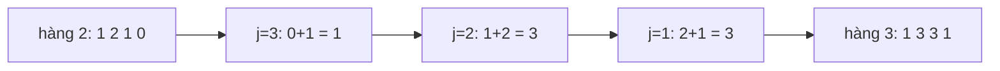

<!-- approaches: Build all rows · One row updated right to left · Binomial formula -->
# 119. Pascal's Triangle II

**Easy** · Array · Dynamic Programming · [LeetCode ↗](https://leetcode.com/problems/pascals-triangle-ii/) · Code: [PascalsTriangleII.java](PascalsTriangleII.java) · Tests: [PascalsTriangleIITest.java](PascalsTriangleIITest.java)

## Đề bài

Trả về **một hàng** (đánh số từ 0) của tam giác Pascal. Follow-up: bộ nhớ `O(k)`.

```
3 -> [1, 3, 3, 1]
```

## Ý tưởng

> Cập nhật **tại chỗ** một mảng duy nhất: `row[j] += row[j−1]`. Phải đi **từ phải sang trái** để `row[j−1]` vẫn còn là giá trị của **hàng cũ** khi được dùng.



Nếu đi trái sang phải: `row[1] = 2 + 1 = 3`, rồi `row[2] = 1 + 3 = 4` ✗ — đã dùng giá trị **mới** của `row[1]`.

## Cách 1 — Dựng từng hàng `O(k²)`

## Cách 2 — Một mảng, cập nhật phải → trái `O(k²) · O(k)` ⭐

Kỹ thuật "duyệt ngược để không ghi đè dữ liệu còn cần" chính là mẹo của **knapsack 0/1 một chiều** (416, 494).

## Cách 3 — Công thức tổ hợp `O(k)`

`C(k, j+1) = C(k, j) · (k − j) / (j + 1)`, nhân trước chia sau, dùng `long`.

## Bài liên quan

118 Pascal's Triangle · 62 Unique Paths · 416 Partition Equal Subset Sum.
