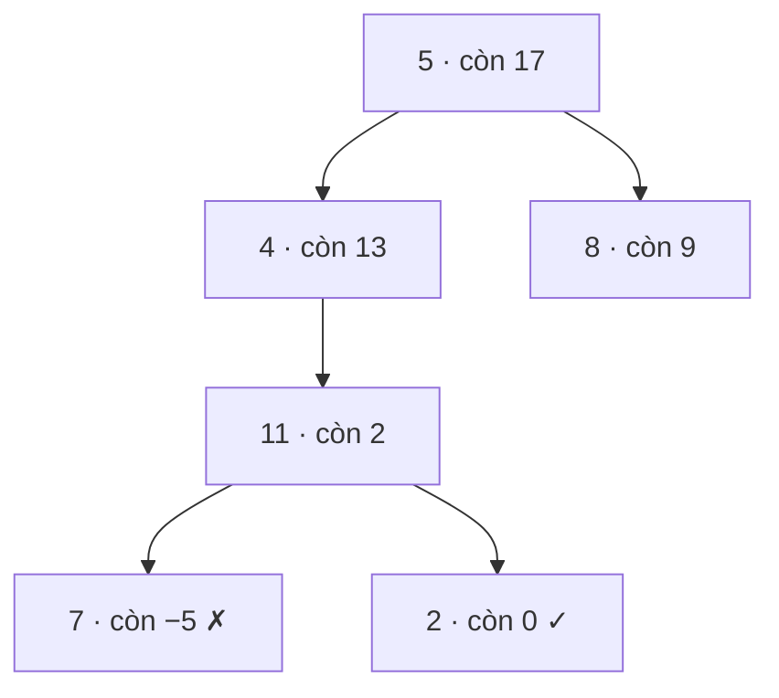

<!-- approaches: Recursive subtract · Iterative stack with sums -->
# 112. Path Sum

**Easy** · Tree · Depth-First Search · Breadth-First Search · Binary Tree · [LeetCode ↗](https://leetcode.com/problems/path-sum/) · Code: [PathSum.java](PathSum.java) · Tests: [PathSumTest.java](PathSumTest.java)

## Đề bài

Có đường đi **từ gốc tới lá** nào mà tổng giá trị bằng `targetSum` không?

```
        5
       / \
      4   8
     /   / \
    11  13  4          target = 22 -> true (5 → 4 → 11 → 2)
   /  \      \
  7    2      1
```

## Ý tưởng

> Đi xuống, **trừ dần** giá trị mỗi node khỏi `target`. Tới lá thì kiểm tra phần còn lại có bằng 0 không.
> "Có đường nào…?" → `||` kết quả hai nhánh (dừng ngay khi một nhánh đúng).



## Cách 1 — Đệ quy trừ dần ⭐

## Cách 2 — Stack các cặp (node, tổng hiện tại)

## Bẫy & lưu ý

- Chỉ kiểm tra tại **lá**. `[1, 2]` với target 1: gốc `1` có tổng bằng 1 nhưng **không phải lá** → `false`.
- Cây rỗng → `false` (kể cả `target = 0`).
- Giá trị có thể âm → **không** cắt tỉa khi tổng vượt `target`.

## Bài liên quan

113 Path Sum II (liệt kê đường đi) · 437 Path Sum III (đường đi bất kỳ, prefix sum) · 257 Binary Tree Paths · 124 Maximum Path Sum.
