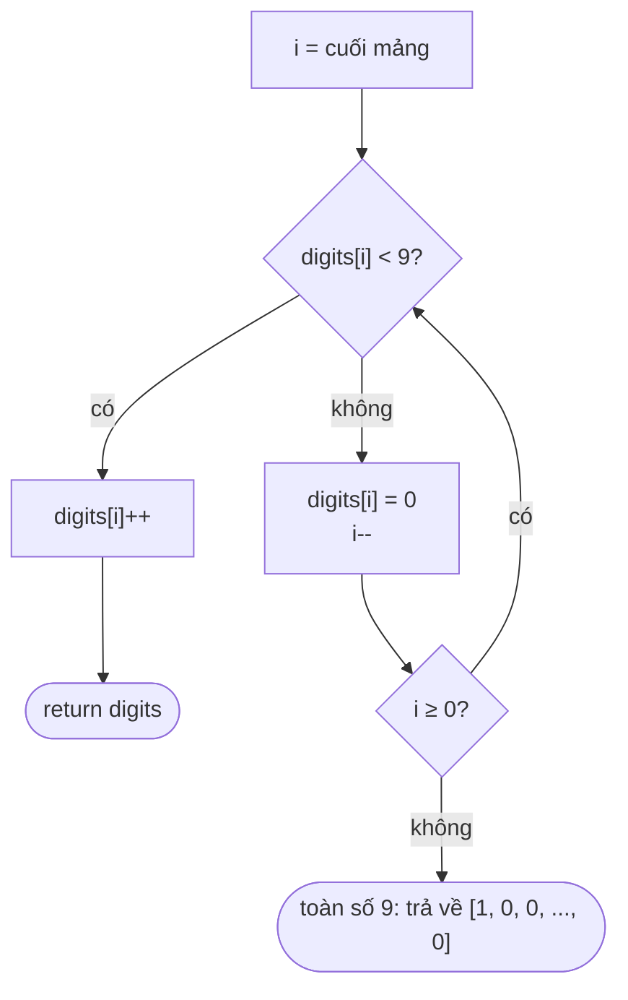

<!-- approaches: Stop at first non-9 · General carry · BigInteger -->
# 66. Plus One

**Easy** · Array · Math · [LeetCode ↗](https://leetcode.com/problems/plus-one/) · Code: [PlusOne.java](PlusOne.java) · Tests: [PlusOneTest.java](PlusOneTest.java)

## Đề bài

Một số rất lớn được lưu dưới dạng mảng chữ số (hàng cao nhất trước). Cộng thêm 1.

```
[1,2,3] -> [1,2,4]      [1,2,9] -> [1,3,0]      [9,9] -> [1,0,0]
```

## Ý tưởng

> Cộng như ở tiểu học, từ **hàng đơn vị**: chữ số `< 9` thì tăng lên và **xong ngay**; chữ số `9` thành `0` và **nhớ 1** sang trái.



## Cách 1 — Dừng ở chữ số đầu tiên khác 9 `O(n) · O(1)` ⭐

| digits | i | hành động |
|---|---|---|
| [1, 2, 9] | 2 | 9 → 0, nhớ |
| [1, 2, 0] | 1 | 2 < 9 → 3, **xong** |
| [1, 3, 0] | | |

Trường hợp toàn `9`: mọi chữ số đã thành `0`, chỉ cần mảng mới dài hơn 1 với `1` ở đầu — `new int[]` mặc định toàn 0.

## Cách 2 — Cộng có nhớ tổng quát `O(n) · O(n)`

`sum = digit + carry`, ghi `sum % 10`, nhớ `sum / 10`. Dài hơn nhưng dùng lại được cho "cộng k" và bài 67 Add Binary, 415 Add Strings.

## Cách 3 — `BigInteger`

Đúng nhưng né mất ý của bài. Dùng làm chuẩn để test.

## Bẫy & lưu ý

- Mảng tối đa 100 chữ số → **không** chuyển sang `long` được (tràn).
- Cách 1 sửa trực tiếp mảng đầu vào; nếu không được phép thì sao chép trước.

## Bài liên quan

67 Add Binary · 415 Add Strings · 2 Add Two Numbers · 43 Multiply Strings.
