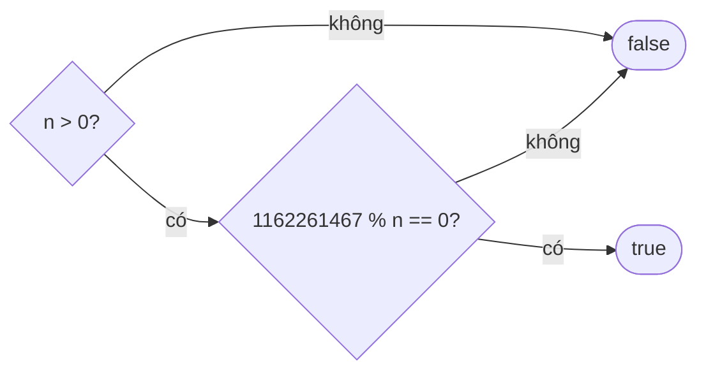

<!-- approaches: Repeated division · Largest power of 3 that fits in int · Logarithm -->
# 326. Power of Three

**Easy** · Math · Recursion · [LeetCode ↗](https://leetcode.com/problems/power-of-three/) · Code: [PowerOfThree.java](PowerOfThree.java) · Tests: [PowerOfThreeTest.java](PowerOfThreeTest.java)

## Đề bài

`n` có phải luỹ thừa của 3 (`3ˣ`, `x ≥ 0`) không? Follow-up: không dùng vòng lặp hay đệ quy.

```
27 -> true      45 -> false      0 -> false
```

## Ý tưởng

> Luỹ thừa 3 **lớn nhất** vừa `int` là `3¹⁹ = 1 162 261 467`. Vì 3 là **số nguyên tố**, ước của `3¹⁹` chỉ có thể là `3⁰, 3¹, …, 3¹⁹`. Vậy `n` là luỹ thừa 3 ⇔ `n > 0` và `3¹⁹ % n == 0`.



## Cách 1 — Chia liên tục cho 3 `O(log n)`

## Cách 2 — Ước của 3¹⁹ `O(1)` ⭐

Mẹo này chỉ đúng với cơ số **nguyên tố** (với 4 thì không: 2 cũng là ước của 4¹⁵).

## Cách 3 — Logarit

`log₃ n` phải nguyên. Dễ sai do sai số dấu phẩy động → làm tròn rồi kiểm tra lại bằng `pow`.

## Bài liên quan

231 Power of Two · 342 Power of Four · 1780 Check if Number is a Sum of Powers of Three.
