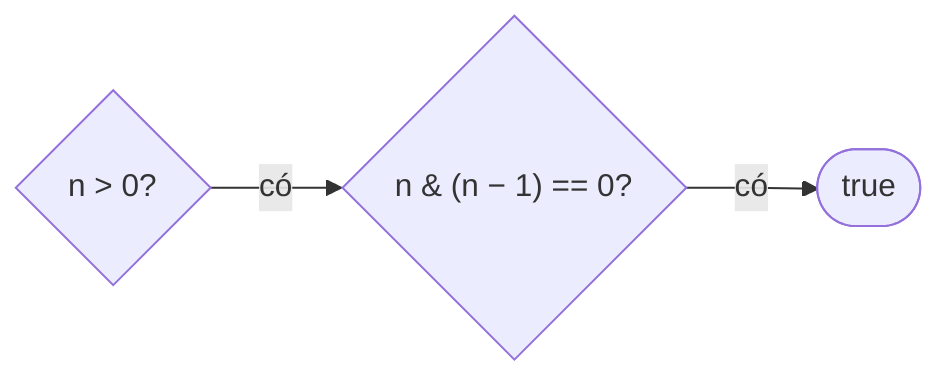

<!-- approaches: Repeated halving · n & (n - 1) == 0 · Lowest set bit -->
# 231. Power of Two

**Easy** · Math · Bit Manipulation · Recursion · [LeetCode ↗](https://leetcode.com/problems/power-of-two/) · Code: [PowerOfTwo.java](PowerOfTwo.java) · Tests: [PowerOfTwoTest.java](PowerOfTwoTest.java)

## Đề bài

`n` có phải luỹ thừa của 2 không? Follow-up: không dùng vòng lặp.

```
16 -> true      6 -> false      0 -> false
```

## Ý tưởng

> Luỹ thừa 2 có **đúng một bit 1** trong biểu diễn nhị phân. `n & (n − 1)` xoá bit 1 thấp nhất → kết quả 0 ⇔ chỉ có một bit.

```
n     = 0001 0000   (16)
n − 1 = 0000 1111
n & (n−1) = 0       ✓

n     = 0000 0110   (6)
n − 1 = 0000 0101
n & (n−1) = 0100    ✗
```



## Cách 1 — Chia đôi liên tục `O(log n)`

## Cách 2 — `n & (n − 1)` `O(1)` ⭐

## Cách 3 — `n & −n == n`

`n & −n` giữ lại **bit 1 thấp nhất** (bù hai). Bằng `n` ⇔ không còn bit nào khác.

## Bẫy & lưu ý

- `n ≤ 0` → `false`. Đặc biệt `Integer.MIN_VALUE` chỉ có một bit 1 nhưng là số âm.

## Bài liên quan

191 Number of 1 Bits · 326 Power of Three · 342 Power of Four · 338 Counting Bits.
