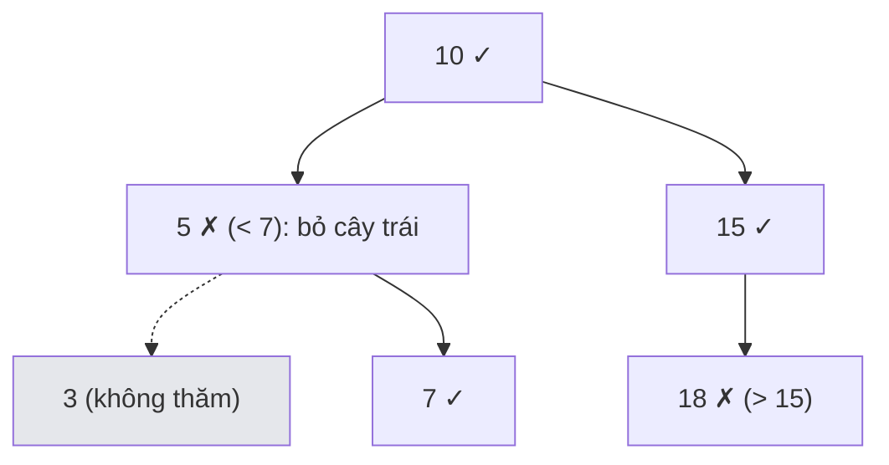

<!-- approaches: DFS with pruning · Iterative stack · Inorder -->
# 938. Range Sum of BST

**Easy** · Tree · Depth-First Search · Binary Search Tree · Binary Tree · [LeetCode ↗](https://leetcode.com/problems/range-sum-of-bst/) · Code: [RangeSumOfBST.java](RangeSumOfBST.java) · Tests: [RangeSumOfBSTTest.java](RangeSumOfBSTTest.java)

## Đề bài

Cho **cây nhị phân tìm kiếm** (BST), tính tổng các giá trị nằm trong `[low, high]`.

```
        10
       /  \
      5    15
     / \     \
    3   7     18          low = 7, high = 15  ->  7 + 10 + 15 = 32
```

## Ý tưởng

> BST: mọi node bên trái < node < mọi node bên phải. Nếu `node.val < low` thì **cả cây con trái** còn nhỏ hơn → **cắt bỏ**, chỉ đi phải (và ngược lại).



## Cách 1 — DFS có cắt tỉa ⭐

Ba trường hợp: `val < low` → đi phải; `val > high` → đi trái; còn lại → cộng `val` và đi cả hai bên.

## Cách 2 — Stack thay đệ quy

Chỉ đẩy con trái khi `node.val > low` (bên trái có thể còn giá trị ≥ low), con phải khi `node.val < high`.

## Cách 3 — Duyệt hết

Bỏ qua tính chất BST, kiểm tra từng node. Dùng làm chuẩn để test.

## Độ phức tạp

`O(n)` trường hợp xấu (khoảng phủ cả cây), nhưng thường chỉ thăm `O(h + k)` node với `k` là số node trong khoảng. Bộ nhớ `O(h)`.

## Bẫy & lưu ý

- Khoảng là **đóng** `[low, high]` — dùng `>=` và `<=`.
- Cây lệch (như danh sách) cao `n` → đệ quy có thể sâu; dùng cách 2 nếu lo tràn stack.

## Bài liên quan

700 Search in a BST · 98 Validate BST · 230 Kth Smallest Element in a BST · 669 Trim a BST.
