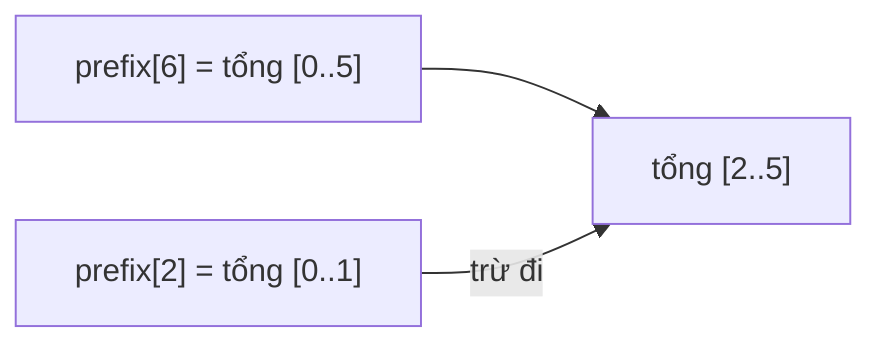

<!-- approaches: Sum on every query · Prefix sums -->
# 303. Range Sum Query - Immutable

**Easy** · Array · Design · Prefix Sum · [LeetCode ↗](https://leetcode.com/problems/range-sum-query-immutable/) · Code: [RangeSumQueryImmutable.java](RangeSumQueryImmutable.java) · Tests: [RangeSumQueryImmutableTest.java](RangeSumQueryImmutableTest.java)

## Đề bài

Thiết kế lớp `NumArray(nums)` trả lời **rất nhiều** truy vấn `sumRange(left, right)` — tổng đoạn `[left, right]`. Mảng không đổi.

```
nums = [-2, 0, 3, -5, 2, -1]
sumRange(0, 2) -> 1      sumRange(2, 5) -> -1
```

## Ý tưởng

> **Tính trước một lần, trả lời mãi mãi.** Lưu tổng tiền tố `prefix[i]` = tổng `i` phần tử đầu.
> Tổng đoạn = tổng tới `right` trừ tổng **trước** `left`: `prefix[right+1] − prefix[left]`.

| i | 0 | 1 | 2 | 3 | 4 | 5 | 6 |
|---|---|---|---|---|---|---|---|
| nums[i] | −2 | 0 | 3 | −5 | 2 | −1 | |
| prefix[i] | 0 | −2 | −2 | 1 | −4 | −2 | −3 |

`sumRange(2, 5) = prefix[6] − prefix[2] = −3 − (−2) = −1` ✅



## Cách 1 — Cộng mỗi lần hỏi: truy vấn `O(n)`

## Cách 2 — Prefix sum: dựng `O(n)`, truy vấn `O(1)` ⭐

Mảng `prefix` dài `n + 1` với `prefix[0] = 0` — mẹo này giúp không phải xử lý riêng `left = 0`.

## Câu hỏi mở rộng

- Mảng **thay đổi** (307)? → Fenwick tree / segment tree: cập nhật và truy vấn `O(log n)`.
- Ma trận (304)? → prefix sum 2D.

## Bài liên quan

304 Range Sum Query 2D · 307 Range Sum Query - Mutable · 560 Subarray Sum Equals K · 724 Find Pivot Index.
