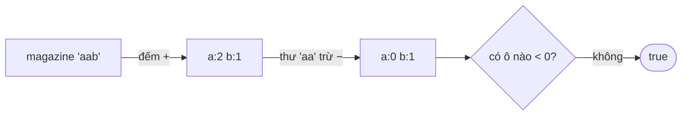

<!-- approaches: Remove from copy · Hash map count · Array of 26 -->
# 383. Ransom Note

**Easy** · Hash Table · String · Counting · [LeetCode ↗](https://leetcode.com/problems/ransom-note/) · Code: [RansomNote.java](RansomNote.java) · Tests: [RansomNoteTest.java](RansomNoteTest.java)

## Đề bài

Có thể cắt chữ từ tờ báo `magazine` (mỗi chữ dùng một lần) để ghép thành lá thư `ransomNote` không?

```
("aa", "ab")  -> false   (báo chỉ có một chữ 'a')
("aa", "aab") -> true
```

## Ý tưởng

> Thứ tự không quan trọng, chỉ **số lượng** từng chữ: báo phải có **đủ** mỗi chữ mà thư cần → **đếm**.



## Cách 1 — Xoá dần trên bản sao `O(m·n)`

Mỗi chữ của thư, tìm và xoá một chữ giống thế trong báo. Trực quan, nhưng `indexOf` + `deleteCharAt` đều `O(n)`.

## Cách 2 — HashMap đếm `O(m+n)`

Đếm chữ của báo; mỗi chữ của thư trừ đi một, về `0` mà vẫn cần → `false`. Dùng được cho mọi bảng chữ cái (Unicode).

## Cách 3 — Mảng 26 phần tử `O(m+n) · O(1)` ⭐

Chỉ có chữ thường → `int[26]`, chỉ số `c − 'a'`. Nhanh hơn HashMap nhiều (không boxing). Mẹo thêm: thư dài hơn báo → `false` ngay.

## Bẫy & lưu ý

- Đếm từ **báo** trước, rồi trừ bằng **thư** — làm ngược lại thì phải kiểm tra khác.
- `--count[i] < 0` gộp "trừ" và "kiểm tra" làm một.

## Bài liên quan

242 Valid Anagram · 387 First Unique Character in a String · 438 Find All Anagrams in a String.
