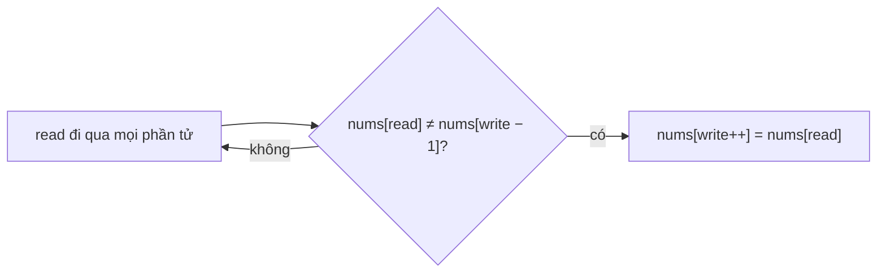

<!-- approaches: Read/write pointers · Generalized keep-k -->
# 26. Remove Duplicates from Sorted Array

**Easy** · Array · Two Pointers · [LeetCode ↗](https://leetcode.com/problems/remove-duplicates-from-sorted-array/) · Code: [RemoveDuplicatesFromSortedArray.java](RemoveDuplicatesFromSortedArray.java) · Tests: [RemoveDuplicatesFromSortedArrayTest.java](RemoveDuplicatesFromSortedArrayTest.java)

## Đề bài

Mảng **đã sắp xếp**; xoá trùng **tại chỗ** để mỗi giá trị còn một lần, trả về số giá trị khác nhau `k`.

```
[0,0,1,1,1,2,2,3,3,4] -> 5, đầu mảng = [0,1,2,3,4]
```

## Ý tưởng

> Đã sắp xếp nên trùng nhau thì **nằm liền nhau**. `write` chỉ tiến khi gặp giá trị **khác** giá trị vừa ghi.



| read | nums[read] | nums[write−1] | ghi? | đầu mảng |
|---|---|---|---|---|
| 1 | 0 | 0 | ✗ | 0 |
| 2 | 1 | 0 | ✓ | 0 1 |
| 3, 4 | 1 | 1 | ✗ | 0 1 |
| 5 | 2 | 1 | ✓ | 0 1 2 |
| … | | | | 0 1 2 3 4 |

## Cách 1 — Con trỏ đọc/ghi `O(n) · O(1)` ⭐

## Cách 2 — Tổng quát: giữ tối đa `k` bản

So với phần tử **cách `k` ô** về trước trong phần kết quả: `x ≠ nums[write − k]`. Với `k = 2` là lời giải bài 80 — một khuôn cho cả họ bài.

## Bài liên quan

80 Remove Duplicates from Sorted Array II · 27 Remove Element · 83 Remove Duplicates from Sorted List · 283 Move Zeroes.
