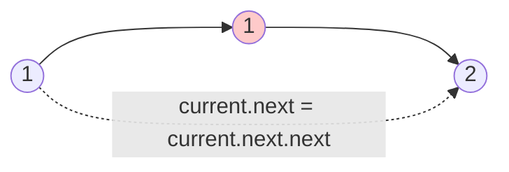

<!-- approaches: Skip duplicates in place · Recursive -->
# 83. Remove Duplicates from Sorted List

**Easy** · Linked List · [LeetCode ↗](https://leetcode.com/problems/remove-duplicates-from-sorted-list/) · Code: [RemoveDuplicatesFromSortedList.java](RemoveDuplicatesFromSortedList.java) · Tests: [RemoveDuplicatesFromSortedListTest.java](RemoveDuplicatesFromSortedListTest.java)

## Đề bài

Danh sách liên kết **đã sắp xếp**; xoá các node trùng để mỗi giá trị chỉ còn một lần.

```
1 → 1 → 2 → 3 → 3   =>   1 → 2 → 3
```

## Ý tưởng

> Đã sắp xếp nên các giá trị trùng **nằm liền nhau**. Đứng ở một node, chừng nào node kế tiếp có cùng giá trị thì "nhảy cóc" qua nó.

## Cách 1 — Một con trỏ `O(n) · O(1)` ⭐



| current | current.next | hành động |
|---|---|---|
| 1 | 1 | trùng → bỏ qua, **đứng yên** |
| 1 | 2 | khác → tiến tới 2 |
| 2 | 3 | tiến tới 3 |
| 3 | 3 | bỏ qua |
| 3 | null | dừng |

Điểm mấu chốt: khi xoá, **không** tiến `current` — có thể còn bản trùng thứ ba (`5 → 5 → 5`).

## Cách 2 — Đệ quy `O(n)` stack

Làm sạch phần đuôi trước; rồi nếu `head` bằng `head.next` thì trả về `head.next` (bỏ `head`).

## Bẫy & lưu ý

- Kiểm tra `current.next != null` trước khi đọc `current.next.val`.
- Biến thể khó hơn: **xoá hết** mọi giá trị có trùng (bài 82) → cần node giả `dummy` vì `head` cũng có thể bị xoá.

## Bài liên quan

82 Remove Duplicates from Sorted List II · 26 Remove Duplicates from Sorted Array · 203 Remove Linked List Elements.
