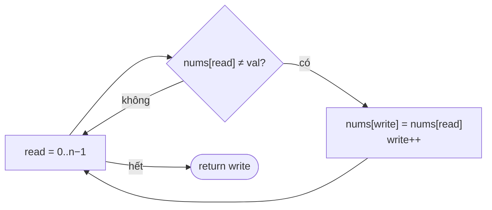

<!-- approaches: Read/write pointers · Swap with last -->
# 27. Remove Element

**Easy** · Array · Two Pointers · [LeetCode ↗](https://leetcode.com/problems/remove-element/) · Code: [RemoveElement.java](RemoveElement.java) · Tests: [RemoveElementTest.java](RemoveElementTest.java)

## Đề bài

Xoá **tại chỗ** mọi phần tử bằng `val`, trả về số phần tử còn lại `k`; `k` ô đầu của `nums` phải chứa các phần tử đó.

```
nums = [3,2,2,3], val = 3   ->  k = 2, nums = [2,2,_,_]
```

## Ý tưởng

> **Hai con trỏ cùng chiều**: `read` đọc qua mọi phần tử, `write` chỉ tiến khi gặp phần tử cần **giữ**.
> Phần `[0, write)` luôn là "mảng kết quả" đã sạch.

## Cách 1 — Con trỏ đọc / ghi `O(n) · O(1)` ⭐



`nums = [0,1,2,2,3,0,4,2], val = 2`:

| read | nums[read] | giữ? | write sau | đầu mảng |
|---|---|---|---|---|
| 0 | 0 | ✅ | 1 | 0 |
| 1 | 1 | ✅ | 2 | 0 1 |
| 2,3 | 2 | ❌ | 2 | 0 1 |
| 4 | 3 | ✅ | 3 | 0 1 3 |
| 5 | 0 | ✅ | 4 | 0 1 3 0 |
| 6 | 4 | ✅ | 5 | 0 1 3 0 4 |
| 7 | 2 | ❌ | **5** | |

Giữ nguyên thứ tự.

## Cách 2 — Đổi với phần tử cuối `O(n) · O(1)`

Gặp `val` thì chép phần tử cuối đè lên và thu ngắn mảng. Ít thao tác ghi khi `val` hiếm (ví dụ xoá 1 phần tử trong 10⁶), nhưng **đổi thứ tự**.
Lưu ý: sau khi chép, **không** tăng `i` vì phần tử vừa chuyển tới có thể cũng là `val`.

## Bẫy & lưu ý

- Đề cho phép thứ tự tuỳ ý — hỏi lại người phỏng vấn trước khi chọn cách 2.
- Khuôn "read/write" dùng lại ở 26, 80, 283 Move Zeroes.

## Bài liên quan

26 Remove Duplicates from Sorted Array · 283 Move Zeroes · 80 Remove Duplicates from Sorted Array II.
