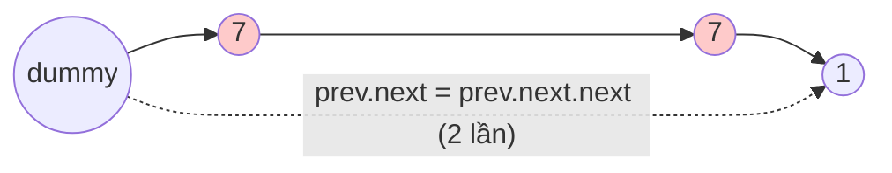

<!-- approaches: Dummy head · Recursive -->
# 203. Remove Linked List Elements

**Easy** · Linked List · Recursion · [LeetCode ↗](https://leetcode.com/problems/remove-linked-list-elements/) · Code: [RemoveLinkedListElements.java](RemoveLinkedListElements.java) · Tests: [RemoveLinkedListElementsTest.java](RemoveLinkedListElementsTest.java)

## Đề bài

Xoá mọi node có giá trị `val` khỏi danh sách liên kết.

```
1 → 2 → 6 → 3 → 4 → 5 → 6, val = 6   =>   1 → 2 → 3 → 4 → 5
```

## Ý tưởng

> Muốn xoá một node phải sửa `next` của node **đứng trước** nó. Node đầu không có node đứng trước → thêm **node giả** `dummy` trước đầu, mọi node thật đều có "người đứng trước".



## Cách 1 — Node giả `O(n) · O(1)` ⭐

Khi xoá, **không** tiến `prev` (node mới tới có thể cũng cần xoá).

## Cách 2 — Đệ quy

Làm sạch phần sau trước, rồi quyết định giữ hay bỏ `head`.

## Bẫy & lưu ý

- Danh sách toàn giá trị cần xoá (`[7,7,7,7]`) → kết quả rỗng; node giả xử lý tự nhiên.

## Bài liên quan

83 Remove Duplicates from Sorted List · 19 Remove Nth Node From End · 237 Delete Node in a Linked List · 27 Remove Element.
