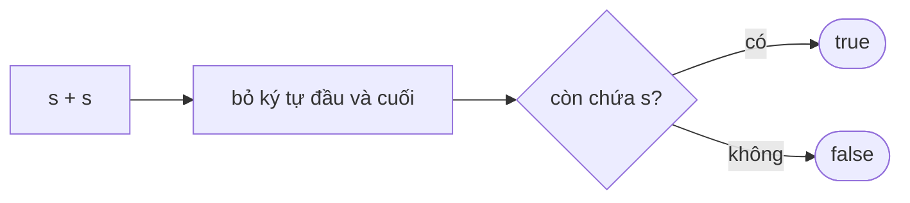

<!-- approaches: Try every divisor length · (s + s) trick · KMP failure function -->
# 459. Repeated Substring Pattern

**Easy** · String · String Matching · Z Algorithm · Knuth–Morris–Pratt Algorithm · [LeetCode ↗](https://leetcode.com/problems/repeated-substring-pattern/) · Code: [RepeatedSubstringPattern.java](RepeatedSubstringPattern.java) · Tests: [RepeatedSubstringPatternTest.java](RepeatedSubstringPatternTest.java)

## Đề bài

`s` có ghép được bằng cách **lặp lại** một chuỗi con của nó (ít nhất hai lần) không?

```
"abab" -> true ("ab" × 2)      "aba" -> false      "abcabcabcabc" -> true
```

## Ý tưởng — mẹo `s + s`

> Nếu `s = PP…P`, thì trong `s + s` (bỏ ký tự đầu và cuối) vẫn tìm thấy `s` ở vị trí `|P|`. Ngược lại, nếu tìm thấy `s` trong `(s + s)[1 .. 2n−1)` ở vị trí `k`, thì `s` trùng với chính nó khi dịch `k` ký tự → có chu kỳ `k` chia hết `n`.

```
s = "abab"     s + s = "a[babab a]b"  → bỏ đầu cuối "bababa" chứa "abab" ✓
s = "aba"      s + s = "a[baab]a"    → "baab" không chứa "aba" ✗
```



## Cách 1 — Thử mọi độ dài khối chia hết `n`

## Cách 2 — Mẹo `s + s` ⭐

## Cách 3 — KMP

Phần **biên** dài nhất `L` (tiền tố đồng thời là hậu tố) cho **chu kỳ nhỏ nhất** `n − L`. `s` lặp lại ⇔ `L > 0` và `n` chia hết cho `n − L`.

## Bài liên quan

28 Find the Index of the First Occurrence · 214 Shortest Palindrome · 1392 Longest Happy Prefix · 686 Repeated String Match.
