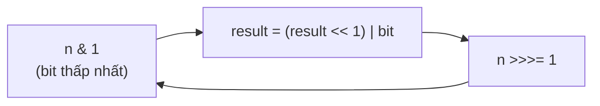

<!-- approaches: Bit by bit · Divide and conquer swaps -->
# 190. Reverse Bits

**Easy** · Divide and Conquer · Bit Manipulation · [LeetCode ↗](https://leetcode.com/problems/reverse-bits/) · Code: [ReverseBits.java](ReverseBits.java) · Tests: [ReverseBitsTest.java](ReverseBitsTest.java)

## Đề bài

Đảo ngược thứ tự 32 bit của một số nguyên không dấu.

```
00000010100101000001111010011100  ->  00111001011110000010100101000000
```

## Ý tưởng

> Giống đảo chữ số thập phân (`r = r·10 + x%10`), nhưng trong hệ 2: lấy bit thấp nhất của `n`, đẩy vào **cuối** `result`, 32 lần.



## Cách 1 — Từng bit, 32 vòng ⭐

Dùng `>>>` (dịch không dấu) để không kéo bit dấu vào khi `n` âm. Phải chạy **đủ 32 vòng** kể cả khi `n` đã bằng 0 — các bit 0 ở đầu cũng phải được đảo xuống cuối.

## Cách 2 — Chia để trị bằng mặt nạ `O(1)`

Đổi chỗ hai nửa 16 bit, rồi trong mỗi nửa đổi chỗ hai byte, rồi hai nibble, hai cặp bit, từng bit. 5 bước cho 32 bit (`log₂ 32`). Đây là cách `Integer.reverse` cài đặt.

## Câu hỏi mở rộng

Gọi hàm hàng triệu lần? → bảng tra 256 giá trị cho mỗi byte, đảo 4 byte rồi ghép.

## Bài liên quan

191 Number of 1 Bits · 7 Reverse Integer · 476 Number Complement.
