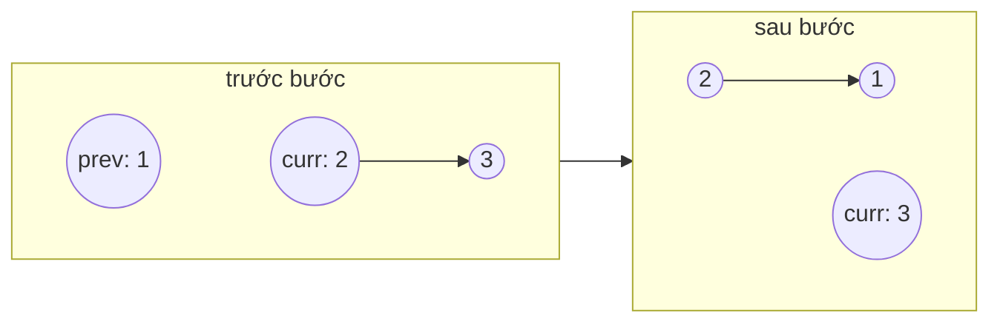

<!-- approaches: Iterative three pointers · Recursive · Stack -->
# 206. Reverse Linked List

**Easy** · Linked List · Recursion · [LeetCode ↗](https://leetcode.com/problems/reverse-linked-list/) · Code: [ReverseLinkedList.java](ReverseLinkedList.java) · Tests: [ReverseLinkedListTest.java](ReverseLinkedListTest.java)

## Đề bài

Đảo ngược danh sách liên kết đơn, trả về đầu mới.

```
1 → 2 → 3 → 4 → 5   =>   5 → 4 → 3 → 2 → 1
```

## Ý tưởng

> Không di chuyển node nào cả — chỉ **quay ngược từng mũi tên** `next`. Cần nhớ node kế tiếp **trước** khi quay, nếu không sẽ mất phần còn lại của danh sách.

Đây là bài linked list quan trọng nhất: là "viên gạch" của 92, 25, 234, 143.

## Cách 1 — Lặp với ba con trỏ `O(n) · O(1)` ⭐



Bốn dòng trong vòng lặp, thứ tự **không được đổi**:

| bước | việc | lý do |
|---|---|---|
| `next = curr.next` | nhớ phần còn lại | sắp ghi đè `curr.next` |
| `curr.next = prev` | quay mũi tên | |
| `prev = curr` | tiến `prev` | |
| `curr = next` | tiến `curr` | |

Khi `curr == null`, `prev` là đầu mới.

## Cách 2 — Đệ quy `O(n)` stack

Giả sử `reverse(head.next)` đã đảo xong phần sau; node `head.next` giờ là **đuôi** của phần đã đảo → cho nó trỏ ngược về `head`, rồi cắt `head.next = null`.

```
1 → [2 ← 3 ← 4 ← 5]      head = 1, head.next = 2 vẫn trỏ tới 2
head.next.next = head:   1 ⇄ 2
head.next = null:        1 ← 2 ← 3 ← 4 ← 5
```

## Cách 3 — Stack `O(n)` bộ nhớ

Đẩy mọi node vào stack, lấy ra theo thứ tự ngược và nối lại. Nhớ cắt `next` của node cuối để tránh chu trình.

## Bẫy & lưu ý

- Quên `head.next = null` trong cách 2 → tạo **chu trình** giữa hai node đầu.
- Danh sách rỗng hoặc một node → trả về nguyên.

## Bài liên quan

92 Reverse Linked List II · 25 Reverse Nodes in k-Group (Hard) · 234 Palindrome Linked List · 143 Reorder List.
