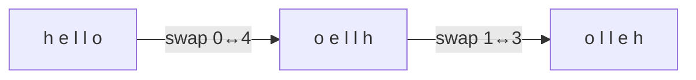

<!-- approaches: Two pointers · Recursion -->
# 344. Reverse String

**Easy** · Two Pointers · String · [LeetCode ↗](https://leetcode.com/problems/reverse-string/) · Code: [ReverseString.java](ReverseString.java) · Tests: [ReverseStringTest.java](ReverseStringTest.java)

## Đề bài

Đảo ngược mảng ký tự **tại chỗ**, bộ nhớ phụ `O(1)`.

```
h e l l o  ->  o l l e h
```

## Ý tưởng

> Hai con trỏ ở hai đầu, **hoán đổi** rồi cùng tiến vào giữa; gặp nhau thì dừng.



## Cách 1 — Hai con trỏ `O(n) · O(1)` ⭐

Chỉ cần `n/2` lần hoán đổi; phần tử giữa (độ dài lẻ) giữ nguyên.

## Cách 2 — Đệ quy

Đúng, nhưng stack `O(n)` vi phạm yêu cầu bộ nhớ — nói được vì sao là điểm cộng.

## Bài liên quan

541 Reverse String II · 557 Reverse Words in a String III · 345 Reverse Vowels of a String · 125 Valid Palindrome.
