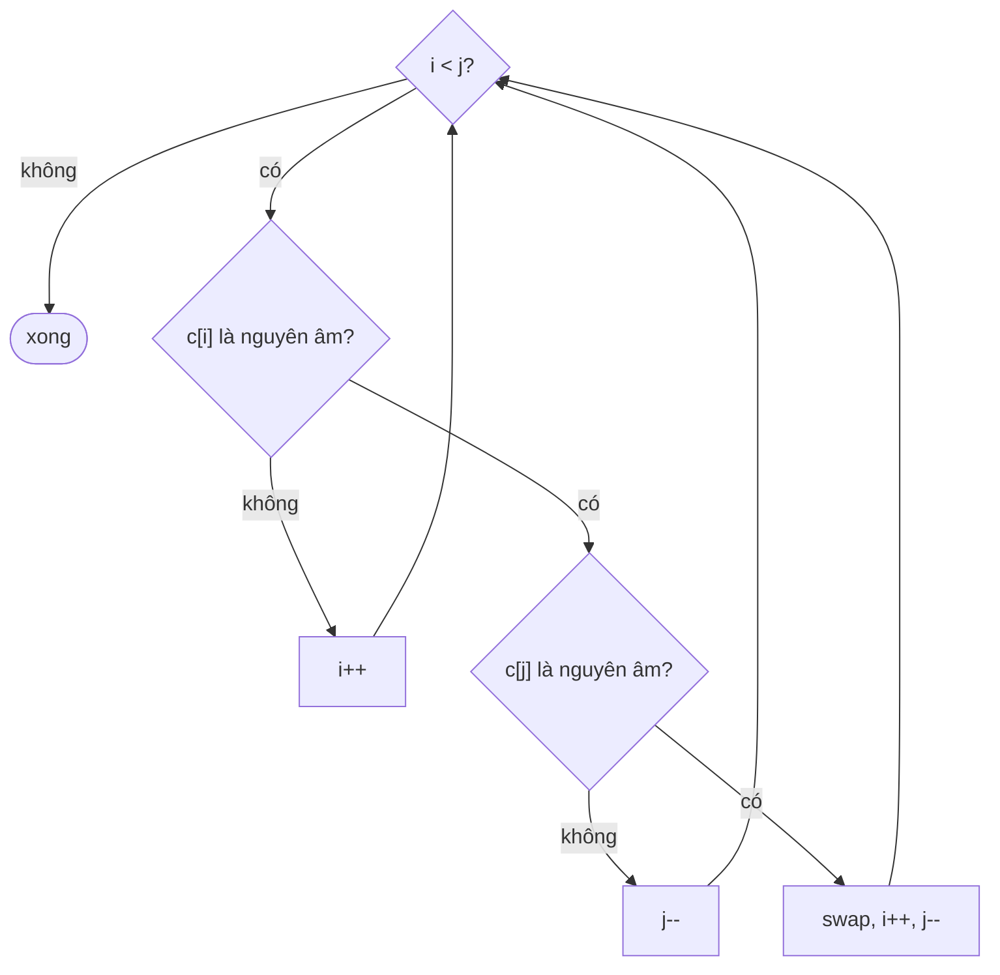

<!-- approaches: Two pointers · Collect and refill -->
# 345. Reverse Vowels of a String

**Easy** · Two Pointers · String · [LeetCode ↗](https://leetcode.com/problems/reverse-vowels-of-a-string/) · Code: [ReverseVowelsOfAString.java](ReverseVowelsOfAString.java) · Tests: [ReverseVowelsOfAStringTest.java](ReverseVowelsOfAStringTest.java)

## Đề bài

Chỉ đảo ngược thứ tự các **nguyên âm** (`a e i o u`, cả hoa và thường), các ký tự khác giữ nguyên chỗ.

```
"leetcode" -> "leotcede"     (e e o e  →  e o e e)
```

## Ý tưởng

> Giống 344 Reverse String, nhưng mỗi con trỏ **bỏ qua phụ âm** cho tới khi đứng trên một nguyên âm, rồi mới hoán đổi.



## Cách 1 — Hai con trỏ ⭐

## Cách 2 — Gom nguyên âm rồi ghi ngược

Lượt 1 gom nguyên âm, lượt 2 thay từng nguyên âm bằng nguyên âm từ cuối danh sách.

## Bẫy & lưu ý

- Nhớ cả chữ **hoa**: `"IceCreAm"`.

## Bài liên quan

344 Reverse String · 125 Valid Palindrome · 917 Reverse Only Letters.
