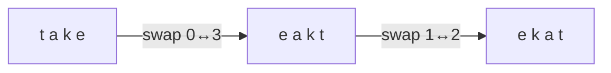

<!-- approaches: Split + reverse · Two pointers on char array -->
# 557. Reverse Words in a String III

**Easy** · Two Pointers · String · [LeetCode ↗](https://leetcode.com/problems/reverse-words-in-a-string-iii/) · Code: [ReverseWordsInAStringIII.java](ReverseWordsInAStringIII.java) · Tests: [ReverseWordsInAStringIIITest.java](ReverseWordsInAStringIIITest.java)

## Đề bài

Đảo ngược ký tự **trong từng từ**, giữ nguyên thứ tự các từ và dấu cách.

```
"Let's take LeetCode contest" -> "s'teL ekat edoCteeL tsetnoc"
```

## Ý tưởng

> Tìm ranh giới mỗi từ (`start` … dấu cách), rồi đảo đoạn đó bằng **hai con trỏ** hoán đổi từ hai đầu vào giữa.



## Cách 1 — `split` + `reverse` + `join` `O(n)`

Gọn, dễ đọc.

## Cách 2 — Mảng ký tự + hai con trỏ `O(n)` ⭐

Một lượt: khi gặp dấu cách (hoặc hết chuỗi) thì đảo đoạn `[start, end − 1]`. Thói quen coi "hết chuỗi" như một dấu cách giúp khỏi viết thêm code xử lý từ cuối.

## Bẫy & lưu ý

- Quên đảo **từ cuối cùng** (không có dấu cách theo sau) — vòng lặp chạy tới `end == length` để xử lý.

## Bài liên quan

344 Reverse String · 151 Reverse Words in a String · 541 Reverse String II.
