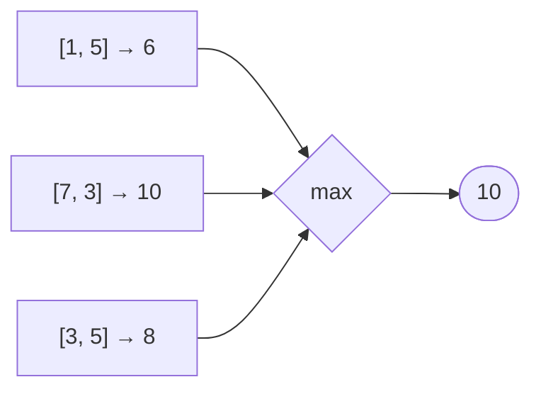

<!-- approaches: Nested loops · Streams -->
# 1672. Richest Customer Wealth

**Easy** · Array · Matrix · [LeetCode ↗](https://leetcode.com/problems/richest-customer-wealth/) · Code: [RichestCustomerWealth.java](RichestCustomerWealth.java) · Tests: [RichestCustomerWealthTest.java](RichestCustomerWealthTest.java)

## Đề bài

`accounts[i][j]` là tiền của khách `i` ở ngân hàng `j`. Tìm tổng tài sản lớn nhất của một khách.

```
[[1,5],[7,3],[3,5]] -> 10   (khách 1: 7 + 3)
```

## Ý tưởng

> Tổng **từng hàng**, lấy **max** các tổng. Bài khởi động để làm quen duyệt mảng hai chiều.



## Cách 1 — Hai vòng lặp `O(m·n)` ⭐

## Cách 2 — Stream

`Arrays.stream(accounts).mapToInt(row -> Arrays.stream(row).sum()).max()` — gọn nhưng chậm hơn chút do overhead stream.

## Bẫy & lưu ý

- Tổng tối đa 50 × 100 = 5000, không lo tràn.

## Bài liên quan

1480 Running Sum of 1d Array · 867 Transpose Matrix.
