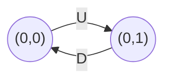

<!-- approaches: Coordinates · Count letters -->
# 657. Robot Return to Origin

**Easy** · String · Simulation · [LeetCode ↗](https://leetcode.com/problems/robot-return-to-origin/) · Code: [RobotReturnToOrigin.java](RobotReturnToOrigin.java) · Tests: [RobotReturnToOriginTest.java](RobotReturnToOriginTest.java)

## Đề bài

Robot bắt đầu ở `(0, 0)`, đi theo chuỗi lệnh `U D L R`. Cuối cùng có về gốc không?

```
"UD" -> true      "LL" -> false
```

## Ý tưởng

> Theo dõi toạ độ `(x, y)`. Về gốc ⇔ số bước lên = số bước xuống **và** số bước trái = số bước phải.



## Cách 1 — Mô phỏng toạ độ `O(n)` ⭐

## Cách 2 — Đếm ký tự `O(n)`

`count['U'] == count['D'] && count['L'] == count['R']`.

## Bài liên quan

874 Walking Robot Simulation · 1041 Robot Bounded In Circle.
