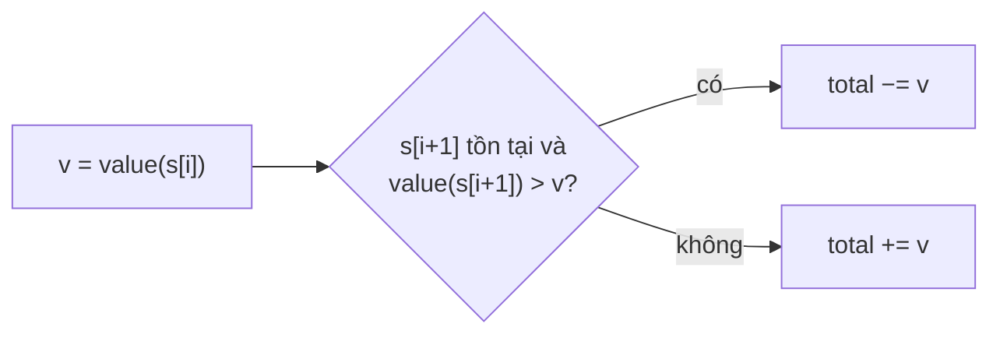

<!-- approaches: Look ahead · Right to left · Pair table -->
# 13. Roman to Integer

**Easy** · Hash Table · Math · String · [LeetCode ↗](https://leetcode.com/problems/roman-to-integer/) · Code: [RomanToInteger.java](RomanToInteger.java) · Tests: [RomanToIntegerTest.java](RomanToIntegerTest.java)

## Đề bài

Đổi số La Mã (1..3999) sang số nguyên. `I=1 V=5 X=10 L=50 C=100 D=500 M=1000`; ký hiệu nhỏ đứng **trước** ký hiệu lớn thì bị **trừ** (`IV=4`, `IX=9`, `XL=40`, `XC=90`, `CD=400`, `CM=900`).

```
"III" -> 3      "LVIII" -> 58      "MCMXCIV" -> 1994  (M + CM + XC + IV = 1000 + 900 + 90 + 4)
```

## Ý tưởng

> Một ký hiệu bị trừ **khi và chỉ khi** ký hiệu ngay sau nó lớn hơn nó. Không cần nhớ 6 trường hợp đặc biệt.

## Cách 1 — Nhìn trước một ký tự `O(n) · O(1)` ⭐



Chạy tay `"MCMXCIV"`:

| i | ký hiệu | v | tiếp theo | thao tác | total |
|---|---|---|---|---|---|
| 0 | M | 1000 | C (100) | + | 1000 |
| 1 | C | 100 | M (1000) | **−** | 900 |
| 2 | M | 1000 | X (10) | + | 1900 |
| 3 | X | 10 | C (100) | **−** | 1890 |
| 4 | C | 100 | I (1) | + | 1990 |
| 5 | I | 1 | V (5) | **−** | 1989 |
| 6 | V | 5 | – | + | **1994** |

## Cách 2 — Duyệt từ phải sang trái `O(n) · O(1)`

Giữ `prev` = giá trị ký hiệu bên phải vừa xét: nhỏ hơn `prev` thì trừ, ngược lại cộng. Không cần kiểm tra biên `i + 1`.

## Cách 3 — Bảng cặp `O(n) · O(1)`

Khớp trước 6 cặp hai chữ (`CM`, `XC`…), không khớp thì cộng ký hiệu đơn. Dài hơn nhưng đọc là hiểu ngay — hợp khi cần giải thích cho người mới.

## Bẫy & lưu ý

- Đừng tra `s.charAt(i + 1)` khi `i` là ký tự cuối.
- `Map.of(...)` cho 7 ký hiệu là đủ; mảng `int[128]` theo mã ký tự còn nhanh hơn.
- Test tốt nhất: đổi **mọi số 1..3999** sang La Mã rồi đổi ngược (xem file test).

## Bài liên quan

12 Integer to Roman (chiều ngược lại, tham lam theo bảng giá trị giảm dần).
