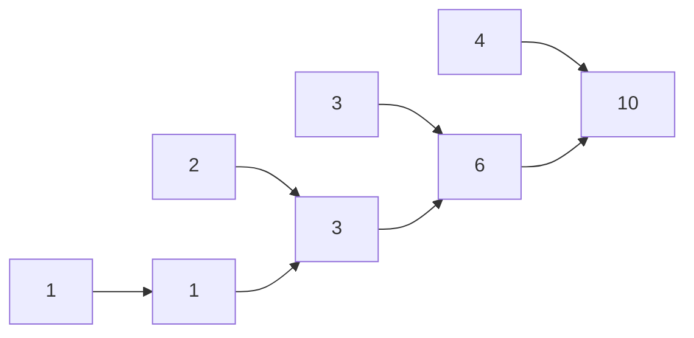

<!-- approaches: New array · In place -->
# 1480. Running Sum of 1d Array

**Easy** · Array · Prefix Sum · [LeetCode ↗](https://leetcode.com/problems/running-sum-of-1d-array/) · Code: [RunningSumOf1dArray.java](RunningSumOf1dArray.java) · Tests: [RunningSumOf1dArrayTest.java](RunningSumOf1dArrayTest.java)

## Đề bài

Trả về mảng **tổng tích luỹ**: `out[i] = nums[0] + … + nums[i]`.

```
[1,2,3,4] -> [1,3,6,10]
```

## Ý tưởng

> `out[i] = out[i−1] + nums[i]` — tổng tới `i` bằng tổng tới `i−1` cộng thêm một phần tử.
> Đây là **prefix sum**, nền tảng của rất nhiều bài: tổng đoạn `[l, r]` = `prefix[r] − prefix[l−1]` trong `O(1)`.



## Cách 1 — Mảng mới `O(n) · O(n)`

## Cách 2 — Ghi đè tại chỗ `O(n) · O(1)` ⭐

`nums[i] += nums[i−1]` từ `i = 1`.

## Bẫy & lưu ý

- Hỏi người phỏng vấn có được sửa mảng đầu vào không.
- Prefix sum với giá trị lớn có thể tràn — dùng `long` khi cần.

## Bài liên quan

303 Range Sum Query - Immutable · 724 Find Pivot Index · 560 Subarray Sum Equals K · 238 Product of Array Except Self.
